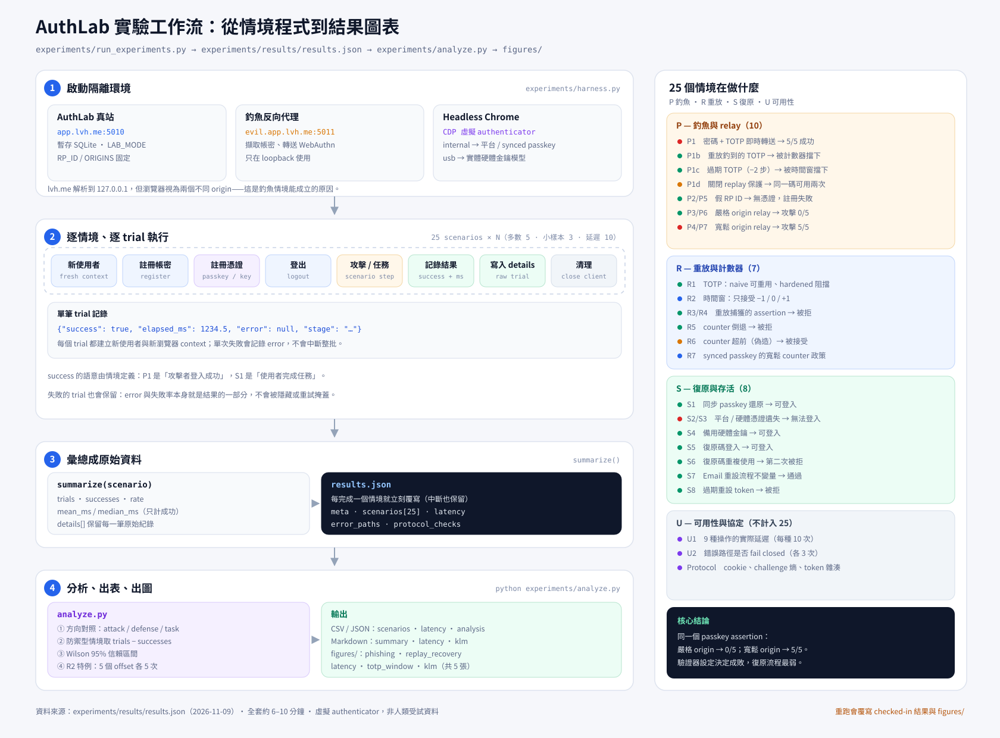

# 實驗工作流圖解



PNG 版：`docs/figures/experiment_workflow.png`

## 怎麼讀這張圖

圖分成四個階段，由左而右、由上而下：

1. **啟動隔離環境**（`experiments/harness.py`）
   - 真正的 AuthLab 跑在 `app.lvh.me:5010`，使用暫存資料庫。
   - 釣魚代理跑在 `evil.app.lvh.me:5011`，負責擷取帳密、轉送 WebAuthn assertion。
   - Headless Chrome 用 CDP 虛擬 authenticator：`internal` 模擬平台/synced passkey，`usb` 模擬實體硬體金鑰。

2. **逐情境、逐 trial 執行**（`experiments/run_experiments.py`）
   - 25 個情境，每個跑 N 次：多數 5 次、小樣本 3 次、延遲量測 10 次。
   - 每個 trial 都是全新使用者：註冊 → 註冊憑證 → 登出 → 攻擊或任務 → 記錄 `success` 與 `elapsed_ms` → 清理。
   - 單次失敗會寫進 `error`，不會中斷整批。

3. **彙總成原始資料**
   - `summarize()` 把 trials 算成 `successes`、`rate`、`mean_ms`、`median_ms`。
   - 每完成一個情境就立刻覆寫 `experiments/results/results.json`，所以中斷也保留已完成的部分。

4. **分析、出表、出圖**（`experiments/analyze.py`）
   - 先對照每個情境的「方向」：攻擊成功、防禦成功、任務完成，或純描述。
   - 防禦型情境（P1b、P1c、P2、P3、P5、P6）把原始「攻擊成功」翻轉成 `trials − successes`。
   - 用 Wilson 方法算 95% 信賴區間，輸出 CSV、Markdown 與 5 張圖。

右側面板列出 25 個情境的分組與目前結果。核心結論是：**同一個 passkey assertion，嚴格 origin 檢查下 0/5 成功，寬鬆 origin 檢查下 5/5 成功**——驗證器設定決定成敗；而復原流程是最弱的一環。

## 重跑

```bash
python experiments/run_experiments.py   # 25 個情境，約 6–10 分鐘
python experiments/analyze.py           # 產生表格與 figures/
```

注意：重跑會覆寫 checked-in 的 `experiments/results/` 與 `figures/`。需要保留現有版本時，先 commit 或備份。

圖中的數字來自 `experiments/results/results.json`（2026-11-09）。實驗使用虛擬 authenticator，屬於 controlled lab study，不是人類受試者資料。
