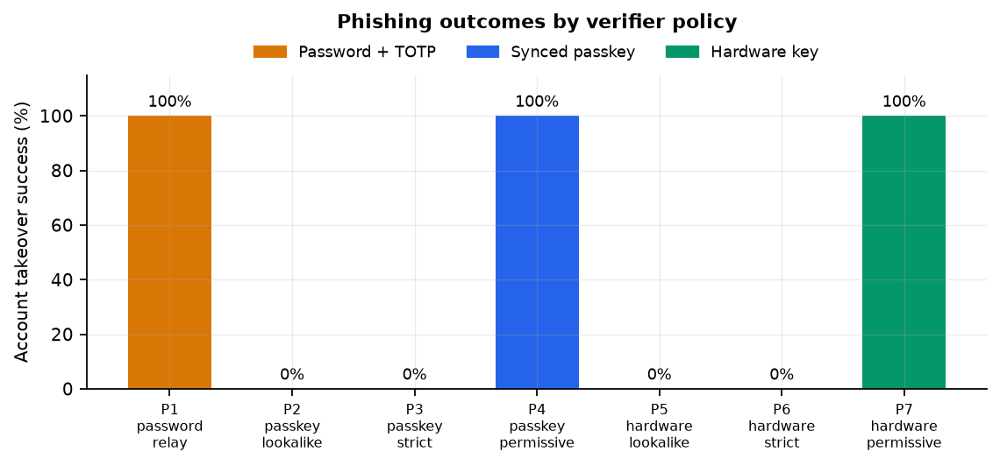
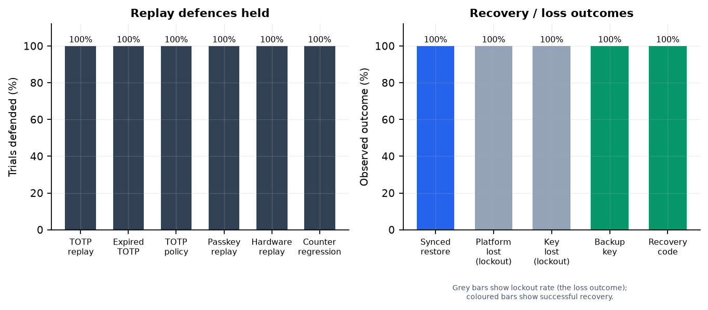
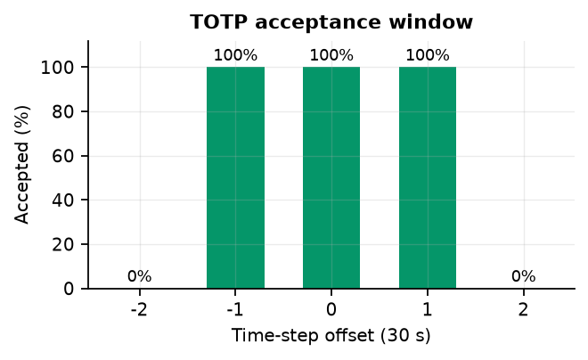
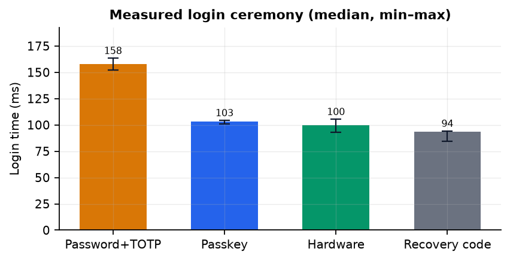
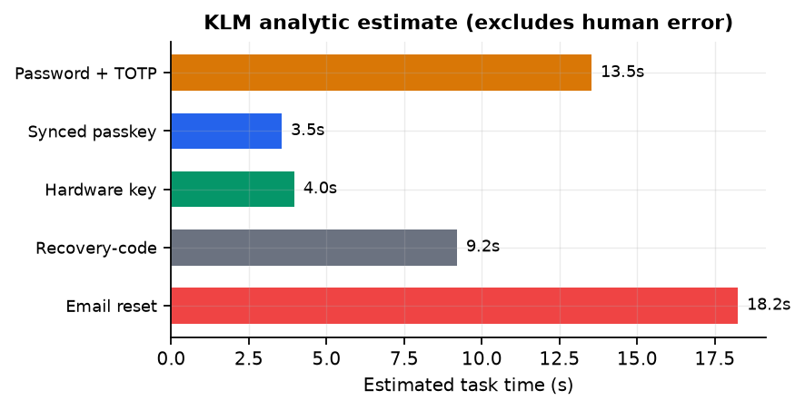

# Beyond TOTP

## Evaluating Phishing Resistance and Account Recovery in Synced Passkeys and Hardware Security Keys

**Interim Report**

**Course:** 4220  
**Prepared by:** yyyyyyynw  
**Date:** 10 November 2026  
**Artifact:** AuthLab v1.0  
**Repository:** <https://github.com/yyyyyyynw/IERG4220Project>  
**Data:** `experiments/results/results.json` (SHA-256 `0553d4be…9c3fe4`)

---

## Abstract

Multi-factor authentication is usually evaluated at the login screen, but an
account is only as strong as its weakest recovery path. This interim report
describes the design, implementation, and preliminary results of a study that
compares three authentication methods — password plus time-based one-time
passwords (TOTP), synced passkeys built on WebAuthn, and hardware FIDO2 security
keys — across phishing resistance, replay protection, device loss, backup, and
usability.

The main artifact is **AuthLab**, a self-contained Flask relying party (RP) with
a real WebAuthn implementation, RFC 6238 TOTP, single-use recovery codes, email
reset tokens, server-side sessions, rate limiting, audit logging, and a
deliberately hostile reverse proxy. Using Chrome DevTools Protocol (CDP) virtual
authenticators, the project runs 25 controlled protocol scenarios with 3–5
trials each, plus 10-trial timing for the main ceremonies and four error-path
probes. The core experiments and analysis are complete; the remaining work is
final validation, integration of the full report, and presentation.

Preliminary results show a clear pattern. Password + TOTP was relayed in real
time in 5/5 trials; replaying the captured code afterwards was blocked 5/5,
demonstrating that replay protection does not prevent the initial phishing
takeover. Synced passkeys and hardware keys both defeated naive lookalikes (0/3
each) and strict origin-checking relays (0/5 each), but both were fully
compromised (5/5 each) when the RP trusted the origin supplied in
`clientDataJSON`. Hardware counter regression was detected 3/3, yet a clone with
a forged higher counter was accepted 3/3, and synced passkeys required a relaxed
counter policy (accepted 3/3). Recovery codes were single-use 3/3; email reset
tokens were single-use, expiring, and revoked old sessions and old passwords
3/3. Measured login ceremonies took about 0.10 s for passkeys and hardware keys
versus 0.16 s for password + TOTP; an analytic Keystroke-Level Model (KLM)
estimated 3.5 s, 4.0 s, and 13.5 s of human task time respectively.

The central finding is that **phishing resistance is a property of the whole
system, not of the credential**. A correct verifier is what turns a passkey or a
hardware key into a phishing-resistant authenticator, and recovery remains the
weakest link for every method.

**Keywords:** WebAuthn, FIDO2, passkeys, TOTP, phishing, account recovery,
usable security, authentication.

---

## 中文摘要

本研究比較三種登入方式：密碼加 TOTP、同步通行金鑰（synced passkey，基於
WebAuthn），以及硬體 FIDO2 安全金鑰。重點不只是登入當下，而是「釣魚抵抗、
重放保護、裝置遺失、備份與帳號復原」的整體安全與可用性。我建立了一個可重現
的 Flask 測試平台 AuthLab，包含真實的 WebAuthn 驗證、RFC 6238 TOTP、一次性
復原碼、Email 重設權杖、Session 撤銷，以及一個故意惡意的反向代理。實驗使用
Chrome CDP 虛擬認證器，執行 25 個控制情境（每個 3–5 次）與延遲量測。

主要初步結果：

- **密碼加 TOTP 無法抵抗即時釣魚。** 攻擊者代理同時轉送密碼與 TOTP，5/5 次
  成功登入；但攻擊者用過後再重放同一組碼，5/5 次被伺服器端計數器阻擋。這說明
  「防重放」不等於「防釣魚」。
- **Passkey 與硬體金鑰的釣魚抵抗取決於 RP 是否檢查 origin。** 嚴格檢查
  origin 時，兩者都 0/5 被攻破；但當 RP 錯誤地信任 `clientDataJSON` 內的
  origin（permissive 模式）時，兩者都 5/5 被攻破。這不是密碼學被破解，而是
  驗證邏輯寫錯。
- **重放與計數器。** TOTP 窗口為 ±1 步（−1/0/+1 接受，±2 拒絕）；捕獲的
  WebAuthn assertion 在 3/3 次重放中被拒絕。硬體金鑰可偵測「落後」的克隆
  （3/3），但「超前」的偽造計數器會被接受（3/3）；同步通行金鑰因跨裝置同步
  而允許非單調計數器（3/3 接受）。
- **復原。** 同步通行金鑰在裝置遺失後可透過同步還原（5/5）；沒有備份的
  平台憑證或硬體金鑰會導致鎖死（3/3）；備用硬體金鑰（3/3）與一次性復原碼
  （3/3）可用；復原碼重複使用被拒（3/3）；Email 重設權杖一次性、會過期、
  會撤銷舊 session 並輪替 TOTP（3/3）。
- **可用性。** 量測到的登入儀式約 0.10 秒（passkey/硬體）對 0.16 秒
  （密碼+TOTP）；KLM 分析模型估計人類任務時間為 3.5 秒、4.0 秒對 13.5 秒。
  復原碼約 9.2 秒，Email 重設約 18.2 秒（不含郵件遞送）。

結論：Passkey 與硬體金鑰是更安全的預設，但前提是 RP 正確驗證 origin、
challenge、RP ID、UV 與計數器政策；復原流程必須被視為主要攻擊面，並採取
一次性、短效、可撤銷、可輪替的設計。硬體金鑰需要備用金鑰；同步通行金鑰
需要可撤銷的帳號層級憑證管理。

---

## Contents

1. Introduction
2. Background and Related Work
3. Research Questions and Hypotheses
4. Methodology
5. Progress to Date
6. Preliminary Results
7. Discussion
8. Remaining Work and Timeline
9. Limitations
10. Conclusion
References
Appendix A. Reproduction Checklist
Appendix B. Repository Map
Appendix C. Glossary

---

## 1. Introduction

### 1.1 Motivation

Phishing is an origin-confusion attack. The victim is not tricked into breaking
cryptography; they are tricked into authenticating to the wrong origin, or into
handing a bearer secret to an intermediary. Password + TOTP improves on
passwords because a stolen password alone is not enough, but the TOTP code is
still a bearer secret that can be relayed in real time. WebAuthn was designed to
remove that bearer property: the private key stays in the authenticator and the
signature is bound to the origin and RP ID [3]. Synced passkeys make WebAuthn
practical for consumer accounts by copying credentials across a user's devices
through a platform sync fabric [5]. Hardware FIDO2 keys make the credential
non-exportable and device-bound [4].

Adoption guidance, however, often stops at "use a passkey; it is
phishing-resistant." That sentence hides two important qualifications. First,
the browser and the RP must both enforce the origin and RP ID rules; a signature
over the wrong origin is still a valid signature. Second, the credential is only
one part of the account. Recovery codes, email reset, backup keys, and sync
accounts are additional authentication surfaces, and they are frequently weaker
than the primary factor.

This project therefore evaluates the three methods as **complete account
systems**, not as isolated login ceremonies. It asks what happens under a
real-time adversary, after device loss, and when the recovery path is abused.

### 1.2 Problem statement

The project addresses one overarching question:

> When an account faces real-time phishing, replay, device loss, and recovery
> abuse, which authentication design still holds — and at what usability cost?

This decomposes into four research questions, stated in §3.

### 1.3 Objectives

The objectives of the project are:

1. **Protocol analysis.** Compare password + TOTP, synced passkeys, and hardware
   FIDO2 keys at the message level, with explicit security invariants and
   failure modes.
2. **Testbed.** Implement a reproducible relying party that supports all three
   methods and can switch between a correct and a deliberately vulnerable
   origin verifier.
3. **Controlled experiments.** Measure phishing resistance, replay protection,
   counter behavior, sync, device loss, backup, recovery-code reuse, email-reset
   replay, and expiry.
4. **Usability measurement.** Measure ceremony latency, analyze error paths, and
   estimate human task time with a KLM model.
5. **Deployment guidance.** Derive recommendations that treat recovery as part
   of the authentication system.

### 1.4 Contributions to date

The interim milestone has produced:

- A message-level protocol comparison with sequence diagrams and invariants.
- AuthLab v1.0, a Flask/WebAuthn/TOTP testbed with strict and permissive origin
  policies, recovery codes, email reset, session revocation, and lab
  instrumentation.
- A Playwright + Chrome CDP experiment harness with a hostile reverse proxy at
  `evil.app.lvh.me:5011`.
- 25 controlled scenarios (3–5 trials each), 10-trial latency measurements, four
  error-path probes, and protocol checks.
- Checked-in raw results, Wilson confidence intervals, five figures, and a KLM
  analysis.
- A full report draft, a Traditional Chinese executive summary, a 15-page
  Chinese project guide, a presentation deck, and a ready-to-run human-subject
  protocol (not executed).

### 1.5 Scope

The experiments use virtual authenticators and loopback servers. They model the
protocol logic faithfully but do not model vendor cloud infrastructure, real
email delivery, malware, or physical coercion. The project does **not** contain
fabricated human-subject data. The human study is shipped as a protocol and
analysis pipeline; it has not been run.

### 1.6 Report structure

Section 2 summarizes the technical background. Section 3 states the research
questions and hypotheses. Section 4 describes the methodology and threat model.
Section 5 reports progress against the objectives. Section 6 presents
preliminary results. Section 7 discusses their meaning. Section 8 sets out the
remaining work and timeline. Section 9 lists limitations, and Section 10
concludes.

---

## 2. Background and Related Work

### 2.1 Password + TOTP

TOTP [1] is a symmetric scheme. The server and the authenticator share a secret
`K`; at time step `t = floor(unix_time / 30)`, both compute
`HMAC-SHA1(K, t)`, truncate it dynamically, and reduce it to six digits. The
server typically accepts the current step and one step on either side to
tolerate clock skew. The code is a bearer secret: anyone who observes it within
its validity window can present it. The password is also a bearer secret,
although it is stored as a scrypt hash [8].

The important security property that TOTP *can* provide is **replay
protection**, but only if the server remembers the last accepted counter for the
account and rejects any code whose counter is not greater. A stateless verifier
that only checks the HMAC will accept the same code repeatedly for the rest of
the window. Rate limiting and account lockout are separate controls; they slow
guessing but do not bind the code to an origin.

### 2.2 WebAuthn and FIDO2

WebAuthn [3] is a public-key authentication API. At registration, the
authenticator generates a key pair scoped to an RP ID, returns the public key
and a credential ID, and signs an attestation object. At authentication, the RP
sends a random challenge; the authenticator signs

```
authenticatorData || SHA-256(clientDataJSON)
```

where `authenticatorData` contains the RP ID hash, flags (user presence, user
verification, backup eligibility, backup state), and a signature counter, and
`clientDataJSON` contains the challenge, the origin, and the ceremony type. The
private key never leaves the authenticator. FIDO2/CTAP2 [4] defines the
corresponding authenticator protocol.

Two bindings matter:

- **RP ID binding.** `authenticatorData.rpIdHash` is `SHA-256(rpId)`. The
  browser will only let a page use an RP ID that is equal to, or a registrable
  domain suffix of, the page's origin host. This is why a completely different
  domain such as `evil.example` cannot obtain an assertion for `app.example`.
- **Origin binding.** `clientDataJSON.origin` is the actual origin of the
  calling page and is covered by the signature. The RP must compare it against
  an allowlist. A relay at `evil.app.example` can obtain a *valid* signature
  because `app.example` is a suffix of `evil.app.example`, but the signed origin
  is `evil.app.example`, not `app.example`. Only the origin check distinguishes
  the two.

### 2.3 Synced passkeys

A synced passkey is a WebAuthn credential whose key material is copied or
escrowed by a platform sync fabric (iCloud Keychain, Google Password Manager, a
password manager, etc.). In WebAuthn terms the credential is **backup eligible**
(`BE=1`) and, while currently backed up, **backed up** (`BS=1`). Syncing makes
device loss survivable: a new device can obtain the same credential and sign
with it. It also means the credential is no longer strictly device-bound. The
sync provider becomes part of the trust boundary, and signature counters may not
be globally monotonic across devices. Servers therefore commonly relax counter
checks for backup-eligible credentials, which weakens clone detection but is
necessary for interoperability [3][5].

### 2.4 Hardware FIDO2 keys

A hardware key is a roaming authenticator (`cross-platform`) whose private key
is non-exportable and bound to the device. It is not synced, so loss of the key
means loss of that credential. Many keys require a PIN or biometric for user
verification; the experiments require UV. Counters are usually monotonic, which
gives the RP a clone-detection signal: a cloned key that is behind the stored
counter will be rejected. A clone that is ahead of the stored counter is not
detected by a simple monotonic check, because `new > stored` is exactly what a
legitimate key produces.

### 2.5 Recovery mechanisms

Three recovery mechanisms are implemented:

1. **Recovery codes.** Ten 8-character codes drawn from a 32-symbol alphabet
   (40 bits each), displayed once at enrolment, stored as scrypt hashes, and
   consumed atomically.
2. **Email reset.** A 32-byte random token is sent by email. Only its SHA-256
   hash is stored. The token expires after 15 minutes, is single-use, and on
   redemption changes the password, rotates the TOTP secret, deletes all
   recovery codes, and revokes every existing session.
3. **Backup key.** A second hardware key enrolled while the account is still
   accessible.

### 2.6 Related work and gap

Current standards and guidance already describe the mechanisms used here.
WebAuthn [3] and CTAP2 [4] define the ceremonies and the RP's verification
obligations; FIDO's passkey material describes sync and backup semantics [5];
NIST SP 800-63B [6] treats phishing resistance and recovery as part of
authenticator assurance; OWASP [7] catalogs implementation pitfalls. Usable-
security research has repeatedly shown that users misunderstand recovery and
that fallback paths dominate real-world risk, but deployment guidance still
tends to evaluate the primary factor in isolation.

The gap this project addresses is **integration**: the same credential can be
phishing-resistant or relayable depending on the verifier; the same account can
be recoverable or permanently locked depending on backup; and the same recovery
mechanism can be safe or catastrophic depending on single-use, expiry, and
revocation semantics. The project turns these statements into executable tests
and measures the difference.

---

## 3. Research Questions and Hypotheses

### 3.1 Research questions

**RQ1 (Phishing).** Can a real-time adversary take over an account protected by
password + TOTP, a synced passkey, or a hardware key?

**RQ2 (Replay).** What stops a captured TOTP code or WebAuthn assertion from
being used twice?

**RQ3 (Recovery).** What happens after device loss, key loss, or a lost phone,
and does the recovery path reopen the phishing or replay hole?

**RQ4 (Usability).** How much time and cognitive work does each method add, and
where does recovery dominate the burden?

### 3.2 Hypotheses

- **H1.** Password + TOTP is vulnerable to real-time relay even when the server
  enforces replay protection, because the first use is legitimate from the
  server's perspective.
- **H2.** Synced passkeys and hardware keys resist naive lookalikes and strict
  origin-checking relays, but fail under a permissive origin verifier that
  trusts `clientDataJSON.origin`.
- **H3.** WebAuthn replay protection comes primarily from challenge and flow
  single-use; signature counters detect lagging clones but not a clone with a
  forged higher counter.
- **H4.** Recovery is the weakest link. Synced passkeys improve availability but
  shift trust to the sync account; hardware keys require a backup key or a
  recovery code.
- **H5.** Passkeys and hardware keys reduce human task time relative to
  password + TOTP, but recovery paths narrow the advantage.

### 3.3 Success criteria

The interim milestone is successful if:

1. All three methods are implemented and can complete real WebAuthn/TOTP
   ceremonies in a browser.
2. The strict and permissive verifier paths are demonstrably different under the
   same relayed assertion.
3. Every scenario produces a recorded outcome and a reproducible artifact.
4. The analysis reports uncertainty rather than treating 3–5 trials as
   population estimates.
5. The remaining work is clearly scoped and achievable within the project
   timeline.

---

## 4. Methodology

### 4.1 Overall design

The study is a controlled, repeated-measures protocol experiment. The
independent variables are (a) authentication method and (b) verifier policy
(strict vs permissive) or recovery path. The dependent variables are attack
success, defense success, task completion, ceremony latency, and protocol
invariants. Each trial uses a fresh user, a fresh browser context, and a fresh
virtual authenticator; there is no cross-trial credential state. Trials are
repeated 3–5 times per scenario (10 for latency tasks) to expose flakiness.

The work combines three lines of evidence:

1. **Protocol analysis** of the messages, state, and invariants.
2. **Controlled experiments** in a real browser with real WebAuthn ceremonies.
3. **Analytic usability modeling** with KLM, plus a ready-to-run human study
   protocol that has not been executed.

### 4.2 AuthLab testbed

AuthLab is a Flask application with five blueprints:

- `pages`: index, dashboard, lab status page.
- `auth`: registration, password + TOTP login, enrolment, sessions.
- `passkeys`: WebAuthn registration/authentication and the lab verifier.
- `recovery`: recovery codes, email reset, session revocation.
- `lab`: token-guarded test instrumentation, disabled unless `AUTHLAB_LAB=1`.

Persistence is SQLite in WAL mode with eight tables: `users`, `credentials`,
`flows`, `sessions`, `recovery_codes`, `recovery_tokens`, `audit_log`, and
`throttle`. The schema is created idempotently at startup. The browser code is
vanilla JavaScript; there is no build step.

| Table | Purpose | Notable fields |
| --- | --- | --- |
| `users` | Account and TOTP state | `password_hash`, `totp_secret`, `totp_last_step`, `webauthn_user_id` |
| `credentials` | WebAuthn public keys | `credential_id`, `public_key`, `sign_count`, `kind`, `backup_eligible`, `backup_state` |
| `flows` | Single-use ceremony state | `flow_id`, `challenge`, `rp_id`, `origin`, `expires_at`, `used` |
| `sessions` | Server-side sessions | `token_hash`, `method`, `expires_at`, `revoked` |
| `recovery_codes` | Hashed one-time codes | `code_hash`, `used_at` |
| `recovery_tokens` | Hashed email tokens | `token_hash`, `expires_at`, `used_at` |
| `audit_log` | Security events | `event`, `method`, `success`, `detail` |
| `throttle` | Rate-limit buckets | `key`, `count`, `window_start` |

The WebAuthn verifier wraps `py_webauthn` 3.0.1 and makes every security
parameter explicit: `expected_rp_id`, `expected_origin`,
`require_user_presence`, `require_user_verification`, and the counter floor. The
normal login endpoint always checks the configured origin list. The lab endpoint
`/lab/webauthn/login/verify` has two policies:

- **strict**: use the configured `ORIGINS` list, exactly like the real endpoint.
- **permissive**: use the origin embedded in the submitted `clientDataJSON` as
  the expected origin. This reproduces a real implementation bug: the signature
  and RP ID are checked, but the origin is taken from the attacker's own
  message.

This is the controlled variable behind P3/P4 and P6/P7.

### 4.3 Threat model

**Assets.** Account access, the credential private key, the TOTP shared secret,
recovery codes, reset tokens, and active sessions.

**Adversary capabilities.**

| ID | Capability | In scope |
| --- | --- | --- |
| A1 | Host a lookalike origin and relay messages in real time | Yes |
| A2 | Control a subdomain under the RP's registrable domain (`evil.app.lvh.me`) | Yes |
| A3 | Capture and replay a TOTP code or WebAuthn assertion within its window | Yes |
| A4 | Steal a device or clone a credential, including modifying a virtual authenticator's counter | Yes |
| A5 | Obtain a recovery code or access the victim's email | Yes, as a recovery-path threat |
| A6 | Break cryptography, read a secure enclave, or modify the RP server | No |
| A7 | Compromise the browser, OS, or sync provider itself | No (discussed qualitatively) |

**Trust boundaries.** The browser/authenticator is trusted to enforce RP ID
scoping and to keep the private key. The RP server is trusted for verification
logic and session management. The sync provider is trusted for availability and
confidentiality of synced key material; this project models its observable
effect (BE/BS flags and non-monotonic counters), not its internals. The email
provider is trusted for delivery; email reset is therefore only as strong as the
email account.

**Out of scope.** Malware on the user's device, session hijacking after a
successful login, SIM swap, phishing of the recovery email itself, physical
coercion, supply-chain attacks, side channels in the browser, and quantum
attacks.

### 4.4 Scenario matrix

The core suite contains 25 protocol scenarios. U1 (latency) and U2 (error paths)
are separate measurement blocks.

| ID | Question | Method | Trials | Expected result |
| --- | --- | --- | ---: | --- |
| P1 | Real-time relay of password + TOTP | Password + TOTP | 5 | Takeover |
| P1b | Replay the phished TOTP code in a fresh session | Password + TOTP | 5 | Blocked |
| P1c | Use a code outside the ±1 window | Password + TOTP | 3 | Blocked |
| P1d | Naive stateless TOTP verifier used twice | Password + TOTP | 5 | Both accepted |
| P2 | Passkey lookalike asks for its own RP ID | Synced passkey | 3 | No credential |
| P3 | Passkey relay; strict origin check | Synced passkey | 5 | Blocked |
| P4 | Passkey relay; permissive origin check | Synced passkey | 5 | Takeover |
| P5 | Hardware lookalike asks for its own RP ID | Hardware key | 3 | No credential |
| P6 | Hardware relay; strict origin check | Hardware key | 5 | Blocked |
| P7 | Hardware relay; permissive origin check | Hardware key | 5 | Takeover |
| R1 | TOTP naive vs counter-enforcing verifier | Password + TOTP | 5 | Naive twice, hardened once |
| R2 | TOTP acceptance by time-step offset | Password + TOTP | 5 | −1/0/+1 accepted |
| R3 | Replay a captured passkey assertion | Synced passkey | 3 | Blocked |
| R4 | Replay a captured hardware assertion | Hardware key | 3 | Blocked |
| R5 | Hardware clone with a lagging counter | Hardware key | 3 | Blocked |
| R6 | Hardware clone with a forged high counter | Hardware key | 3 | Accepted (limitation) |
| R7 | Synced credential with zero/non-monotonic counter | Synced passkey | 3 | Accepted (policy) |
| S1 | Lose device A; restore synced passkey on B | Synced passkey | 5 | Login succeeds |
| S2 | Lose a device-bound platform credential | Synced passkey | 3 | Lockout |
| S3 | Lose the only hardware key | Hardware key | 3 | Lockout |
| S4 | Lose key A; use enrolled backup key B | Hardware key | 3 | Login succeeds |
| S5 | Lose hardware key; use a recovery code | Hardware key | 3 | Login succeeds |
| S6 | Reuse a recovery code | All | 3 | Second use blocked |
| S7 | Email reset: single use, revocation, rotation | All | 3 | All invariants hold |
| S8 | Use an expired reset token | All | 3 | Rejected |

P2–P4 enrol a platform passkey; the sync-specific behaviour is modelled
separately in S1 and R7. Because syncing does not change origin binding, the
phishing result applies to both device-bound and synced platform credentials.

U1 measured 10 trials for each of registration, password + TOTP login, passkey
enrolment/login, and hardware enrolment/login; 3 trials for email request/reset
and recovery-code login. U2 measured 3 trials for each of four error paths.

### 4.5 Apparatus

| Component | Version / setting |
| --- | --- |
| Host | macOS 15.7.7, arm64 |
| Python | 3.11.1 |
| Browser | Google Chrome 156.0.8078.80, headless |
| Automation | Playwright 1.63.0 (Python) |
| WebAuthn library | py_webauthn 3.0.1 |
| RP server | Flask development server, loopback |
| Real RP | `http://app.lvh.me:5010` |
| Phishing proxy | `http://evil.app.lvh.me:5011` |
| Authenticators | Chrome CDP virtual authenticators, CTAP2.1 |
| Database | SQLite, WAL, temporary per run |
| Secure-context flag | `--unsafely-treat-insecure-origin-as-secure` for the two loopback origins |

The two hostnames resolve to `127.0.0.1` through public wildcard DNS
(`lvh.me`). Chrome is launched with `--no-proxy-server` so an ambient HTTP proxy
cannot intercept loopback traffic.

### 4.6 Procedure and controls

For each trial:

1. Start a fresh temporary SQLite database and a fresh Flask app.
2. Start the real RP and the hostile proxy on loopback.
3. Create a fresh browser context and a virtual authenticator.
4. Register a random username with the fixed test password.
5. Enrol the required credential(s).
6. Log out, perform the scenario action, and record the outcome.
7. Inspect the database for counters, sessions, and token state.

Controls: same application code, same browser build, same machine, same test
password, same TOTP generation, same phishing page, and the same harness
timeouts. The only intentional differences are the method and the verifier
policy. The phishing page is served from the same proxy in all phishing trials.

### 4.7 Metrics and statistics

- **Attack success** = the attacker reaches `/dashboard` or the proxy confirms a
  dashboard session.
- **Defense success** = the attack or misuse is blocked.
- **Task success** = the legitimate user completes the recovery/login task.
- **Latency** = wall-clock time from the first page action to the dashboard
  redirect (login) or the enrolled confirmation (enrolment).
- **Protocol checks** = boolean/integer properties read from cookies, tokens, and
  the database.

Rates are reported with 95% Wilson score intervals [10]. With 3–5 trials the
intervals are wide (for 5/5, 0.57–1.00; for 3/3, 0.44–1.00). The scenarios are
deterministic protocol properties rather than random samples of users, so the
intervals describe binomial uncertainty, not population effect sizes. I do not
report p-values; the interesting variation is between policies, and it is
categorical.

### 4.8 Ethics and safety

The phishing proxy is deliberately hostile. It is bound to loopback, uses
disposable accounts in a temporary database, and is never exposed to a network
or pointed at a real service. No real credentials, personal data, or human
subjects are involved. The human study is a protocol only; if it is run later,
it requires ethics approval, informed consent, and the ability to withdraw. The
repository documents these boundaries in `docs/ethics.md`.

### 4.9 Validity

**Internal validity.** Fresh databases and browser contexts prevent cross-trial
contamination. The strict/permissive switch changes only the expected origin;
the same credential and challenge are used. The TOTP window test uses
`update=False` and `enforce_replay=False`, so each offset is independent.

**Construct validity.** "Attack success" is operationalized as reaching the
dashboard, which is the account-takeover goal. "Defense success" is the
complement. Latency measures the ceremony, not human decision time; the KLM
model fills that gap analytically.

**External validity.** Virtual authenticators implement CTAP2.1 and real
WebAuthn ceremonies, but they are not physical keys and do not model vendor sync
infrastructure. The loopback network removes WAN latency. The phishing proxy is
a real reverse proxy, but the victim is automated. These choices favor internal
control over ecological realism.

---

## 5. Progress to Date

### 5.1 Protocol analysis — complete

`docs/protocol_analysis.md` and `docs/threat_model.md` document the message
flows for TOTP login, WebAuthn registration/authentication, synced-passkey
restore, hardware-key counter policy, recovery codes, and email reset. The
analysis identifies the invariants that the experiments then test: challenge
freshness, flow single-use, origin allowlisting, RP ID binding, UV, counter
monotonicity, code single-use, token expiry, session revocation, and factor
rotation.

### 5.2 Implementation — complete

AuthLab v1.0 implements all three authentication methods and all recovery paths.
The strict verifier is the production path; the permissive verifier exists only
in lab mode and is protected by a per-run token. The testbed also exposes
ground-truth state (TOTP secret and last step, credential counters, sessions,
remaining recovery codes, audit events) so the harness can verify outcomes
rather than infer them from the UI.

The synced-passkey model is implemented by exporting a platform credential from
virtual authenticator A, re-importing it into B with `BE=1, BS=1`, and marking
the server record as synced. This preserves the public key and credential ID, so
the server's verification path is unchanged. It models the observable protocol
effect of sync, not a vendor cloud.

### 5.3 Experiments — complete

The full suite ran on 9 November 2026 in 345.85 seconds. It produced 25 scenario
records, latency samples, error-path records, and protocol checks in
`experiments/results/results.json`.

### 5.4 Analysis and writing — mostly complete

`experiments/analyze.py` computes Wilson intervals, latency statistics, the KLM
model, and five figures. A full report draft (`docs/REPORT.md`), a Chinese
summary (`docs/SUMMARY_zh.md`), a 15-page Chinese guide
(`docs/PROJECT_GUIDE_zh.pdf`), and a 12–15 minute presentation deck
(`docs/slides.md`) exist. The human-subject protocol, questionnaire, and analysis
pipeline are in `survey/`.

### 5.5 Status against objectives

| Objective | Status | Evidence |
| --- | --- | --- |
| Protocol analysis | Complete | `docs/protocol_analysis.md`, `docs/threat_model.md` |
| Testbed | Complete | `authlab/`, verified end-to-end flows |
| Phishing experiments | Complete | P1–P7, `results.json` |
| Replay/counter experiments | Complete | R1–R7, `results.json` |
| Recovery experiments | Complete | S1–S8, `results.json` |
| Latency and error paths | Complete | U1–U2, `latency.csv`, `summary.md` |
| Analytic usability model | Complete | `klm.md`, `figures/klm.png` |
| Human-subject study | Not executed (protocol ready) | `survey/` |
| Final report | Draft complete; integration remains | `docs/REPORT.md` |
| Presentation | Draft deck complete; rehearsal remains | `docs/slides.md` |

### 5.6 Deviations from the original plan

Three deviations are worth recording:

1. **Virtual authenticators instead of physical keys.** Physical FIDO2 keys were
   not available for repeated automated trials. Chrome CDP virtual
   authenticators implement real WebAuthn ceremonies and allow counter
   manipulation, which is essential for R5/R6. The trade-off is that hardware
   transport, vendor firmware, and physical user presence are not exercised.
2. **No human-subject data.** Running a study would require ethics approval and
   recruitment beyond the project timeline. The project instead ships a
   complete protocol, questionnaire, and analysis pipeline, and uses KLM for an
   analytic estimate. No synthetic data is presented as human data.
3. **Port 5010 instead of 5000.** macOS Control Center occupies port 5000 on the
   test machine, so the lab uses 5010/5011. This is documented in the README.

---

## 6. Preliminary Results

### 6.1 Phishing



| ID | Scenario | Method | Policy | Attack success | 95% CI |
| --- | --- | --- | --- | ---: | --- |
| P1 | Real-time password + TOTP relay | Password + TOTP | strict | 5/5 (100%) | 0.57–1.00 |
| P2 | Passkey lookalike, attacker RP ID | Synced passkey | strict | 0/3 (0%) | 0.00–0.56 |
| P3 | Passkey relay | Synced passkey | strict | 0/5 (0%) | 0.00–0.43 |
| P4 | Passkey relay | Synced passkey | permissive | 5/5 (100%) | 0.57–1.00 |
| P5 | Hardware lookalike, attacker RP ID | Hardware key | strict | 0/3 (0%) | 0.00–0.56 |
| P6 | Hardware relay | Hardware key | strict | 0/5 (0%) | 0.00–0.43 |
| P7 | Hardware relay | Hardware key | permissive | 5/5 (100%) | 0.57–1.00 |
| P1d | Naive TOTP verifier, same code twice | Password + TOTP | none | 5/5 (100%) | 0.57–1.00 |

**Password + TOTP.** The proxy relayed the password and the current TOTP code
to the real RP, received a session, and reached the dashboard in every trial
(5/5). The mean server-plus-proxy time was 47 ms. The attack does not need to
break anything; it simply uses the victim's credentials at the real origin
before the code expires.

**Replay is not phishing protection.** In P1b the attacker first completed the
relay, then tried the same code in a fresh session. The second attempt failed
5/5 because the server's `totp_last_step` had advanced. This is a correct and
important defense, but it does not undo the first takeover. P1c confirmed that a
code two steps old is rejected 3/3. P1d confirmed that a naive verifier that does
not store the counter accepts the same code twice 5/5.

**Passkeys.** In P2 the lookalike asked for an RP ID equal to its own host
(`evil.app.lvh.me`). No credential existed for that RP ID, so the browser failed
before the server saw an assertion (0/3). In P3 the proxy relayed the real
challenge and RP ID; the browser produced a valid signature because
`app.lvh.me` is a suffix of `evil.app.lvh.me`, but the signed origin was
`http://evil.app.lvh.me:5011`. The strict verifier rejected every assertion
(0/5). In P4 the same assertion was submitted to the permissive verifier, which
took the origin from `clientDataJSON`; every attempt was accepted (5/5).

**Hardware keys.** The pattern is identical: P5 0/3 (attacker RP ID), P6 0/5
(strict origin), P7 5/5 (permissive origin). The hardware key's non-exportable
private key does not help if the RP accepts a signature over the wrong origin.

**Interpretation.** The credential is necessary but not sufficient. WebAuthn's
phishing resistance is realized only when the RP checks the origin that the
authenticator signed. A single missing comparison turns a phishing-resistant
credential into a relayable one.

### 6.2 Replay and counter policies



| ID | Scenario | Method | Observed | 95% CI | Reading |
| --- | --- | --- | ---: | --- | --- |
| R1 | TOTP naive vs hardened | Password + TOTP | 5/5 | 0.57–1.00 | Hardened rejects second use |
| R2 | TOTP window | Password + TOTP | 5/5 offsets | — | −1/0/+1 accepted; ±2 rejected |
| R3 | Passkey assertion replay | Synced passkey | 3/3 | 0.44–1.00 | Same-flow and fresh-flow replay blocked |
| R4 | Hardware assertion replay | Hardware key | 3/3 | 0.44–1.00 | Both replays blocked |
| R5 | Lagging hardware clone | Hardware key | 3/3 | 0.44–1.00 | Counter regression rejected |
| R6 | Forged high-counter clone | Hardware key | 3/3 | 0.44–1.00 | Clone accepted (limit of counters) |
| R7 | Synced non-monotonic counter | Synced passkey | 3/3 | 0.44–1.00 | Accepted under relaxed policy |

**TOTP.** R1 shows the contrast directly: the naive verifier accepts the same
code twice, while the hardened verifier accepts the first use and rejects the
second. R2 shows the acceptance window:

| Offset (30 s steps) | Accepted | Rate |
| ---: | ---: | ---: |
| −2 | 0/5 | 0% |
| −1 | 5/5 | 100% |
| 0 | 5/5 | 100% |
| +1 | 5/5 | 100% |
| +2 | 0/5 | 0% |



**WebAuthn assertions.** R3 and R4 captured a real assertion and replayed it
twice: once against the consumed flow (same `flow_id`) and once against a fresh
flow with a new challenge. Both failed in every trial. The first is blocked by
atomic flow consumption; the second by the challenge mismatch. This is a
stronger replay defense than a counter alone because it does not depend on
authenticator state.

**Counter limits.** R5 cloned a hardware credential with a counter lower than
the stored value; the server rejected it 3/3. R6 cloned with a counter of
`original + 10`; the server accepted it 3/3 because `new > stored` is exactly the
legitimate condition. Counters detect rollback, not a clone that is ahead. R7
shows the synced-passkey exception: a backup-eligible platform credential with a
zero/non-monotonic counter is accepted 3/3. This is the price of cross-device
sync.

### 6.3 Sync, device loss, backup, and recovery

| ID | Scenario | Method | Observed | 95% CI | Reading |
| --- | --- | --- | ---: | --- | --- |
| S1 | Lose device A; restore synced passkey on B | Synced passkey | 5/5 | 0.57–1.00 | Login succeeds |
| S2 | Lose device-bound platform credential | Synced passkey | 3/3 | 0.44–1.00 | Lockout observed |
| S3 | Lose the only hardware key | Hardware key | 3/3 | 0.44–1.00 | Lockout observed |
| S4 | Lose key A; use backup key B | Hardware key | 3/3 | 0.44–1.00 | Login succeeds |
| S5 | Lose key; use recovery code | Hardware key | 3/3 | 0.44–1.00 | Login succeeds |
| S6 | Reuse a recovery code | All | 3/3 | 0.44–1.00 | Second use blocked |
| S7 | Email reset invariants | All | 3/3 | 0.44–1.00 | Single use, revocation, rotation |
| S8 | Expired reset token | All | 3/3 | 0.44–1.00 | Rejected (400) |

**Sync and loss.** S1 restored the credential onto a second virtual
authenticator with BE/BS flags; the server accepted it 5/5. S2 removed the only
platform authenticator and observed lockout 3/3; this models a device-bound
platform credential with no sync, not a synced passkey. S3 removed the only
hardware key and observed lockout 3/3. S4 enrolled a second hardware key while
the session was still valid and logged in with it 3/3. S5 used a recovery code
after removing the hardware key 3/3.

**Recovery-code single use.** S6 logged in with a code, logged out, and tried
the same code again. The second attempt was rejected 3/3. The database update is
atomic, so concurrent attempts cannot both win.

**Email reset.** S7 checked five things in each trial: the first reset returns
200; a replay of the same token returns 400; the pre-reset session is redirected
to login; the old password no longer works; the new password plus the rotated
TOTP works. All five held 3/3. The token was 43 characters, and the database
stored only its SHA-256 hash. S8 forced the token's `expires_at` into the past
and received 400 3/3.

### 6.4 Usability



| Task | n | Median ceremony (ms) | KLM estimate (s) |
| --- | ---: | ---: | ---: |
| Registration | 10 | 389 | — |
| Password + TOTP login | 10 | 158 | 13.5 |
| Passkey enrolment | 10 | 1024 | — |
| Passkey login | 10 | 103 | 3.5 |
| Hardware enrolment | 10 | 1031 | — |
| Hardware login | 10 | 100 | 4.0 |
| Recovery-code login | 3 | 94 | 9.2 |
| Email reset request | 3 | 89 | — |
| Email reset submit | 3 | 42 | 18.2 (excludes delivery) |



The login ceremonies are fast in all three methods because the machine does the
typing and the virtual authenticator is local. Passkey and hardware login
medians (103 ms and 100 ms) are slightly lower than password + TOTP (158 ms),
which includes two server round trips and TOTP verification. The enrolment
figures (~1.0 s) are dominated by credential creation in Chrome's virtual
authenticator; they do not include the harness's subsequent 0.9 s reload wait.
These numbers are **not** human task times. They measure the ceremony and server
work, not reading, typing, finding a phone, or touching a key.

The KLM model follows Card, Moran, and Newell [9] with M = 1.35 s, P = 1.10 s,
K = 0.20 s, H = 0.40 s, and B = 1.00 s. It assumes an experienced user and no
errors. Under those assumptions, password + TOTP costs 13.5 s, a synced passkey
3.5 s, a hardware key 4.0 s, a recovery code 9.2 s, and email reset 18.2 s
excluding mail delivery. The recovery paths narrow the usability advantage of
the stronger credentials, which is one reason recovery deserves first-class
design attention.

### 6.5 Error paths and protocol checks

| Probe | Method | Blocked | Observed UI time | Feedback |
| --- | --- | ---: | ---: | --- |
| Wrong password | Password + TOTP | 3/3 | ~800 ms | `Invalid username or password.` |
| Wrong TOTP | Password + TOTP | 3/3 | ~3.9 s | `Invalid or already-used code.` |
| No passkey credential | Synced passkey | 3/3 | ~9.9 s | `Cancelled or no matching credential.` |
| No hardware credential | Hardware key | 3/3 | ~9.9 s | `Cancelled or no matching credential.` |

The observed UI times include Playwright wait timeouts for the unsuccessful
redirect, so they are not server latencies. The meaningful result is that all
four error paths failed closed and produced a non-ambiguous message. The long
waits are a usability issue for users who have no matching authenticator; a
production UI should offer a recovery link immediately.

| Check | Result |
| --- | --- |
| Session cookie `HttpOnly` | true |
| Session cookie `SameSite` | `Lax` |
| Session cookie `Secure` | false (loopback HTTP; must be true in production) |
| WebAuthn challenge entropy | 64 bytes |
| Recovery token length | 43 characters |
| Recovery token hashed at rest | true |
| Recovery token plaintext absent | true |

The challenge is 64 random bytes, well above the 16-byte minimum recommended for
WebAuthn challenges. The recovery token is 32 random bytes encoded as 43
base64url characters; only its SHA-256 hash is stored. The `Secure` flag is false
because the lab runs over HTTP on loopback; this is a deployment note, not a
protocol failure.

### 6.6 Summary of findings

| Hypothesis | Result | Status |
| --- | --- | --- |
| H1: TOTP relay succeeds despite replay protection | P1 5/5, P1b 5/5 blocked | Supported |
| H2: WebAuthn fails only when origin check is wrong | P2/P3/P5/P6 0/5; P4/P7 5/5 | Supported |
| H3: Challenge/flow single-use is the replay defense | R3/R4 3/3 blocked | Supported |
| H3: Counters detect only lagging clones | R5 3/3 blocked; R6 3/3 accepted | Supported |
| H4: Recovery is the weakest link | S2/S3 lockout; S1/S4/S5 recovery works | Supported |
| H5: Stronger credentials are faster | KLM 3.5/4.0 s vs 13.5 s | Supported analytically |

---

## 7. Discussion

### 7.1 Verifier correctness dominates

The most important result is not that passkeys beat TOTP. It is that the *same*
passkey and the *same* hardware key can be phishing-resistant or fully
relayable depending on one comparison in the RP. P3 and P6 show the correct
behavior; P4 and P7 show the failure when the verifier takes the origin from the
attacker's `clientDataJSON`. The signature is valid in both cases. The property
that changes is semantic: whether the RP checks what the signature actually
covers.

This has a practical implication for deployment guidance. "Use a passkey" is
not a security guarantee. The guarantee is "use a passkey and verify the
expected origin, RP ID hash, challenge, and UV on the server." The browser's RP
ID scoping blocks the naive lookalike, but it does not block a relay from a
subdomain, because the RP ID is a suffix of that subdomain. Only the origin
check does.

### 7.2 The synced-passkey paradox

Syncing solves the availability problem: S1 restored a credential onto a second
device and logged in 5/5. It also creates two new dependencies. First, the sync
account becomes a trust anchor: compromising it may compromise every synced
credential. Second, counters cannot be assumed to be globally monotonic across
devices. R7 shows the server accepting a non-monotonic counter under a relaxed
policy. That is a deliberate compatibility decision, but it means the counter is
weak clone evidence for synced credentials.

The correct conclusion is not "syncing is insecure." It is that synced
passkeys trade clone detection for availability, and that this trade-off must be
documented and paired with account-level credential management and revocation.
Deleting a credential on the server is the only reliable revocation; wiping one
device may leave the synced credential alive elsewhere.

### 7.3 Hardware keys and the recovery weak link

The hardware key has the strongest anti-copying property: the private key is
non-exportable. R5 confirms that a lagging clone is rejected. But R6 shows the
limit: a clone with a forged counter above the stored value is accepted, because
`new > stored` is exactly what a legitimate key produces. Counters are a
rollback detector, not a cloning detector.

Hardware keys also fail closed on loss. S3 produced lockout 3/3 when the only
key was removed. S4 shows the mitigation: enrol a backup key while the account
is still accessible. S5 shows the fallback: a recovery code. The security of the
hardware-key deployment therefore depends as much on backup and recovery design
as on the key itself.

### 7.4 TOTP: replay protection is not phishing protection

P1 and P1b are the clearest pair in the study. The relay succeeds 5/5 because
the password and code are valid at the real RP. The replay then fails 5/5
because the server's `totp_last_step` has advanced. Both results are correct, and
together they show why "we have replay protection" is not an answer to phishing.
The attacker does not need to reuse the code; the first use is enough.

P1d shows the other failure mode: a stateless verifier accepts the same code
twice. This is a real implementation risk in multi-server deployments where the
counter is lost or not shared. The defense is server-side state, not the TOTP
algorithm.

### 7.5 Recovery is an authentication surface

The recovery results are less dramatic than the phishing results, but they
matter more for real accounts. S6 shows single-use recovery codes; S7 shows that
email reset is single-use, expiring, revokes old sessions, and rotates the TOTP
secret; S8 shows expiry enforcement. These are the invariants that prevent a
recovery path from becoming a permanent backdoor.

The design lesson is that recovery must be treated as a first-class
authentication surface: hashed at rest, single-use, short-lived, rate-limited,
auditable, and destructive on success. A reset should invalidate every prior
factor and session, not just add a new password. The email-reset request
endpoint is not rate-limited in AuthLab; that is a documented production
hardening step, not a claim that the current implementation is complete.

### 7.6 Implications for deployment

The results support the following recommendations:

1. **Check the origin explicitly.** Compare `clientDataJSON.origin` against an
   exact allowlist and verify `rpIdHash`. Never derive the expected origin from
   the submitted assertion.
2. **Make challenges and flows single-use.** Atomic consumption with a TTL is
   the primary WebAuthn replay defense; do not rely on counters for this.
3. **Document the counter policy.** Strict monotonic counters for hardware keys;
   an explicit, documented relaxation for backup-eligible credentials. Do not
   claim clone detection that the policy cannot provide.
4. **Design recovery before deployment.** Single-use codes, hashed at rest,
   throttled; email tokens that expire, are single-use, and revoke sessions and
   rotate factors on redemption.
5. **Require a backup factor.** A second hardware key or a synced passkey should
   be enrolled at account creation, not after loss.
6. **Offer recovery at the point of failure.** The no-credential error path
   waited about 9.9 s in automation and offered no immediate alternative; a
   production UI should link to recovery immediately.
7. **Harden the deployment.** Rate-limit reset requests, set `Secure` cookies
   behind HTTPS, review CSRF protections, and monitor the audit log.

---

## 8. Remaining Work and Timeline

### 8.1 Remaining tasks

The core implementation and experiments are complete. The remaining work is:

1. **Final report integration.** Merge this interim material with the full
   results, expand the related-work section, and produce the final submitted
   PDF.
2. **Clean-machine reproducibility.** Re-run the suite from a fresh clone in a
   clean virtual environment and record any differences. The protocol outcomes
   should be stable; latency will vary.
3. **Optional physical-key validation.** If a hardware key is available, repeat
   P5–P7 and R5/R6 with a physical authenticator to check that the virtual
   results transfer. This is a validation, not a requirement for the core
   claims.
4. **Optional browser comparison.** Repeat the phishing scenarios in Firefox or
   Safari if time permits. The origin/RP ID rules are standardized, but browser
   behavior and UI differ.
5. **Human study decision.** The protocol and analysis pipeline are ready. If
   ethics approval and recruitment are available, run a small pilot (n = 8–12)
   and report it as a pilot. If not, keep it as future work and do not present
   synthetic data as human data.
6. **Production hardening notes.** Add the email-reset rate limit, document
   `Secure` cookie deployment, and review CSRF and attestation policy.
7. **Presentation and demo.** Rehearse the 12–15 minute deck, prepare a live
   AuthLab demo, and record a fallback video in case the demo environment fails.
8. **Release.** Tag the repository `v1.0`, verify the checked-in result hash, and
   archive the submission artifact.

### 8.2 Timeline

| Week | Dates | Work | Deliverable |
| --- | --- | --- | --- |
| 1 | 10–16 Nov | Clean-machine rerun; fix documentation drift; finalize results tables | Reproducibility note; frozen result hash |
| 2 | 17–23 Nov | Expand related work and discussion; integrate interim and full report | Final report draft v2 |
| 3 | 24–30 Nov | Optional physical-key/browser validation; polish figures; internal review | Validation appendix; final PDF |
| 4 | 1–7 Dec | Rehearse presentation; live demo; buffer for corrections | Slides, demo, submission |

The timeline reserves the final week as buffer. If optional validation is not
possible, weeks 3–4 are used for report quality and presentation instead.

### 8.3 Risks and mitigation

| Risk | Impact | Mitigation |
| --- | --- | --- |
| Physical key unavailable | Optional validation cannot run | Keep virtual-authenticator results as the primary evidence; state the limitation explicitly |
| Clean-machine differences | Latency or browser version changes | Report the environment and hash; treat protocol outcomes as the stable result |
| Human study not approved | No human data | Keep the protocol as future work; do not fabricate data |
| Time overrun | Final report rushed | Freeze experiments now; prioritize writing and presentation |
| Demo failure | Presentation disruption | Record a fallback video and keep a static results walkthrough |

### 8.4 What will not be done

To keep the scope honest, the final report will **not** claim:

- that virtual authenticators are equivalent to physical keys;
- that the lab models a vendor sync cloud;
- that 3–5 trials estimate population attack rates;
- that the KLM estimate is a human-subject measurement;
- that AuthLab is production-hardened.

These are boundaries, not failures. The contribution is a controlled,
reproducible demonstration of where the security properties come from.

---

## 9. Limitations

1. **Virtual authenticators.** Chrome CDP authenticators implement CTAP2.1 and
   real WebAuthn ceremonies, but they are not physical keys. They do not model
   transport, firmware, or vendor-specific attestation.
2. **No vendor sync implementation.** The synced-passkey model uses credential
   export/re-import with BE/BS flags and a server-side sync marker. It captures
   the observable protocol effect, not the cloud infrastructure.
3. **Loopback network.** The lab removes WAN latency and real email delivery.
   Latency numbers are ceremony times, not user-perceived end-to-end times.
4. **Small samples.** Each scenario has 3–5 trials. Wilson intervals are wide,
   and the results are deterministic protocol properties rather than population
   estimates.
5. **One browser.** Only Chrome was tested. Firefox and Safari may differ in UI
   and in edge-case behavior.
6. **No human subjects.** Usability is measured by ceremony latency and an
   analytic KLM model. The human study protocol is ready but not executed.
7. **No formal verification.** The protocol analysis is manual and
   implementation-driven; no ProVerif/Tamarin model was built.
8. **Hardening gaps.** The email-reset request endpoint is not rate-limited,
   `Secure` is false on loopback HTTP, and attestation is set to `none`. These
   are documented production steps, not hidden assumptions.

---

## 10. Conclusion

At the interim milestone, the project has a working testbed, a complete
experimental suite, checked-in data, and a clear preliminary answer to its
research questions. Password + TOTP is relayable in real time even when replay
protection works. Synced passkeys and hardware keys are phishing-resistant only
when the RP verifies the origin that the authenticator signed; the same
credential fails completely under a permissive verifier. WebAuthn replay
protection comes from challenge and flow single-use, while counters detect only
lagging clones. Recovery is the weakest link for every method, and syncing trades
clone detection for availability.

The remaining work is validation, integration, and presentation, not a redesign.
The final report will preserve the same evidence boundary: real measurements,
explicit uncertainty, and no fabricated human data.

---

## References

[1] D. M'Raihi, S. Machani, M. Pei, and J. Rydell. *TOTP: Time-Based One-Time
Password Algorithm*. RFC 6238, IETF, 2011.
<https://www.rfc-editor.org/rfc/rfc6238>

[2] D. M'Raihi, M. Bellare, F. Hoornaert, D. Naccache, and O. Ranen. *HOTP: An
HMAC-Based One-Time Password Algorithm*. RFC 4226, IETF, 2005.
<https://www.rfc-editor.org/rfc/rfc4226>

[3] W3C. *Web Authentication: An API for accessing Public Key Credentials Level
2*. W3C Recommendation, 8 April 2021. <https://www.w3.org/TR/webauthn-2/>

[4] FIDO Alliance. *Client to Authenticator Protocol (CTAP) 2.1*. FIDO Alliance
Specification, 2021.
<https://fidoalliance.org/specs/fido-v2.1-ps-20210615/>

[5] FIDO Alliance. *Passkeys*. <https://fidoalliance.org/passkeys/>

[6] NIST. *Digital Identity Guidelines: Authentication and Lifecycle
Management*. NIST Special Publication 800-63B, 2017.
<https://doi.org/10.6028/NIST.SP.800-63b>

[7] OWASP. *Authentication Cheat Sheet*.
<https://cheatsheetseries.owasp.org/cheatsheets/Authentication_Cheat_Sheet.html>

[8] C. Percival. *Stronger Key Derivation via Sequential Memory-Hard Functions*.
RFC 7914, IETF, 2016. <https://www.rfc-editor.org/rfc/rfc7914>

[9] S. K. Card, T. P. Moran, and A. Newell. "The Keystroke-Level Model for User
Performance Time with Interactive Systems." *Communications of the ACM*,
23(7):396–410, 1980. <https://doi.org/10.1145/358886.358895>

[10] E. B. Wilson. "Probable Inference, the Law of Succession, and Statistical
Inference." *Journal of the American Statistical Association*, 22(158):209–212,
1927. <https://doi.org/10.1080/01621459.1927.10502953>

[11] Chrome DevTools Protocol. *WebAuthn Domain*.
<https://chromedevtools.github.io/devtools-protocol/tot/WebAuthn/>

[12] Microsoft. *Playwright for Python*. <https://playwright.dev/python/>

[13] Duo Labs. *py_webauthn*. <https://github.com/duo-labs/py_webauthn>

[14] Pallets Projects. *Flask Documentation*. <https://flask.palletsprojects.com/>

---

## Appendix A. Reproduction Checklist

1. Python 3.11+, Google Chrome, and `pip install -r requirements.txt`.
2. Free ports 5010 and 5011: `pkill -f "run.py"`.
3. Confirm `app.lvh.me` and `evil.app.lvh.me` resolve to `127.0.0.1`; if not,
   add the two `/etc/hosts` entries.
4. Run `python3 experiments/run_experiments.py` (about 6–10 minutes).
5. Run `python3 experiments/analyze.py` to regenerate tables and figures.
6. Inspect `experiments/results/results.json` for `meta.environment`,
   `scenarios`, `latency`, `error_paths`, and `protocol_checks`.
7. Verify the raw result hash:
   `shasum -a 256 experiments/results/results.json` should begin with
   `0553d4be`.

The suite is deterministic in protocol outcomes. Latency varies by machine.

## Appendix B. Repository Map

```
authlab/                  Flask testbed (RP, TOTP, recovery, lab controls)
  routes/auth.py          registration, password + TOTP, sessions
  routes/passkeys.py      WebAuthn registration/authentication, origin policy
  routes/recovery.py      recovery codes, email reset, session revocation
  routes/lab.py           token-guarded test instrumentation
  security.py             scrypt, RFC 6238 TOTP, sessions, flows
  webauthn_service.py     py_webauthn wrappers and counter policy
  static/app.js           browser WebAuthn serialization and timing
experiments/
  harness.py              Playwright/CDP lab, virtual authenticators
  phishing_server.py      hostile lookalike reverse proxy (research only)
  run_experiments.py      25 scenarios, writes results.json
  analyze.py              Wilson CIs, latency, KLM, figures
  results/                checked-in results and generated tables
docs/
  REPORT.md               full report draft
  SUMMARY_zh.md           Traditional Chinese executive summary
  PROJECT_GUIDE_zh.pdf    15-page Chinese guide for collaborators
  threat_model.md         assets, adversaries, trust boundaries
  protocol_analysis.md    message-level analysis
  experiment_design.md    variables, controls, validity
  ethics.md               ethics and safe-use boundaries
  slides.md               presentation deck
survey/
  study_protocol.md       human-subject protocol (not executed)
  questionnaire.md        SUS, NASA-TLX, trust, preference
  analyze_survey.py       analysis pipeline with --selftest
```

## Appendix C. Glossary

| Term | Meaning |
| --- | --- |
| RP | Relying Party; the server that verifies authentication. AuthLab is the RP. |
| RP ID | WebAuthn domain suffix that scopes a credential; `app.lvh.me` in the lab. |
| Origin | Scheme, host, and port of the calling page; the value the RP must check. |
| Challenge | Random per-ceremony value that prevents replay. |
| UV | User verification: PIN or biometric. |
| BE / BS | Backup eligibility / backup state flags on a WebAuthn credential. |
| Counter | Authenticator signature counter used as a clone signal. |
| Synced passkey | A backup-eligible WebAuthn credential available across devices. |
| TOTP | Time-based one-time password; a shared secret between server and user. |
| Replay | Reusing a captured TOTP code or WebAuthn assertion. |
| KLM | Keystroke-Level Model; an analytic estimate of human task time. |
| Wilson CI | Confidence interval for a binomial proportion, used with small samples. |
