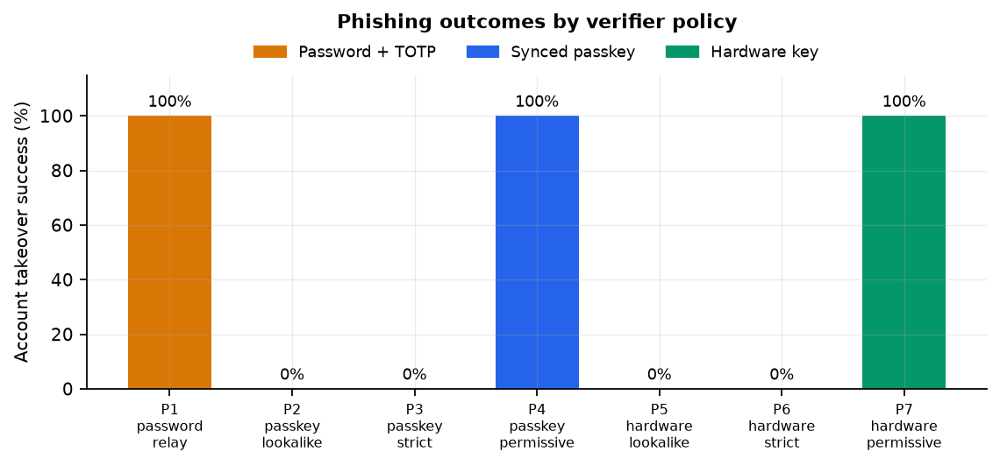
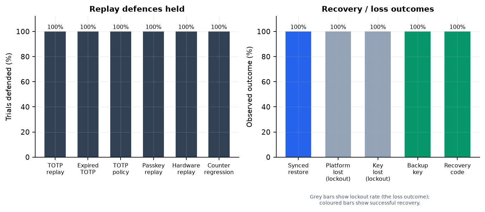
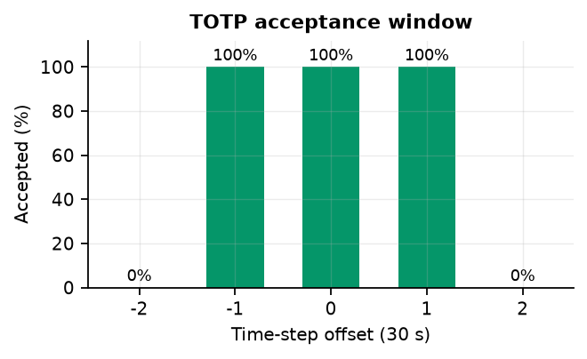
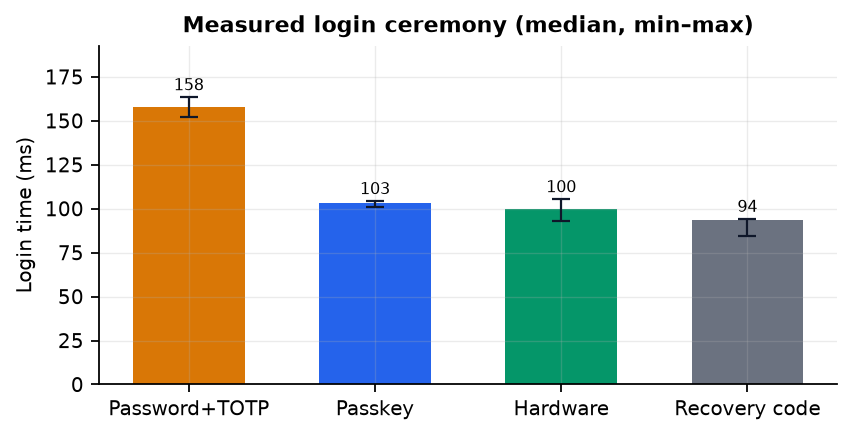
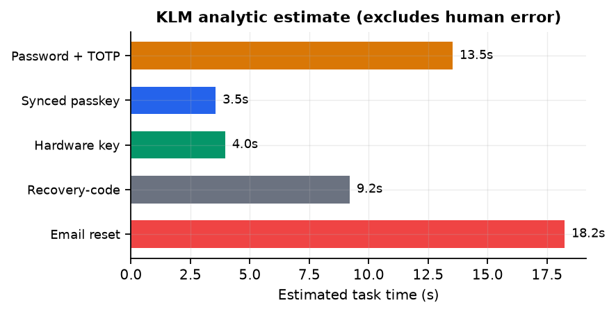

# Beyond TOTP

## Evaluating Phishing Resistance and Account Recovery in Synced Passkeys and Hardware Security Keys

**Course:** 4220  
**Date:** 9 November 2026  
**Artifact:** AuthLab v1.0 (this repository)  
**Data:** `experiments/results/results.json` (SHA-256 `0553d4be…9c3fe4`)

---

## Abstract

Multi-factor authentication is usually evaluated on the login screen, but an
account is only as strong as its weakest recovery path. This project compares
three authentication methods — password plus time-based one-time passwords
(TOTP), synced passkeys built on WebAuthn, and hardware FIDO2 security keys —
across phishing resistance, replay protection, device loss, backup, and
usability. I built AuthLab, a self-contained Flask relying party (RP) with a
real WebAuthn implementation, RFC 6238 TOTP, single-use recovery codes, email
reset tokens, session revocation, and a deliberately hostile reverse proxy.
Using Chrome DevTools Protocol virtual authenticators, I ran 25 controlled
scenarios with 3–5 trials each, plus 10-trial timing for the main login
ceremonies and protocol checks. Password + TOTP was relayed in real time in 5/5 trials; replaying the
captured code afterwards was blocked in 5/5, showing that replay protection
does not prevent the initial phishing takeover. Synced passkeys and hardware
keys both defeated naive lookalikes (0/3 each) and strict origin-checking relays
(0/5 each), but both were fully compromised (5/5 each) when the RP trusted the
origin supplied in `clientDataJSON`. Hardware counter regression was detected
3/3, yet a clone with a forged higher counter was accepted 3/3, and synced
passkeys required a relaxed counter policy (accepted 3/3). Recovery codes were
single-use 3/3; email reset tokens were single-use, expiring, and revoked old
sessions and invalidated old passwords 3/3. Measured login ceremonies were about 0.10 s for
passkeys and hardware keys versus 0.16 s for password + TOTP; an analytic
KLM model estimated 3.5 s, 4.0 s, and 13.5 s of human task time respectively.
The central finding is that phishing resistance is a property of the whole
system, not of the credential: a correct verifier is what turns a passkey or a
hardware key into a phishing-resistant authenticator, and recovery remains the
weakest link for every method.

**Keywords:** WebAuthn, FIDO2, passkeys, TOTP, phishing, account recovery,
usable security, authentication.

---

## Chinese Executive Summary (中文摘要)

> 完整中文摘要見 [`docs/SUMMARY_zh.md`](SUMMARY_zh.md)。

本研究比較三種登入方式：密碼加 TOTP、同步通行金鑰（synced passkey，基於
WebAuthn），以及硬體 FIDO2 安全金鑰，重點不只是登入當下，而是「釣魚抵抗、
重放保護、裝置遺失、備份與帳號復原」的整體安全與可用性。我建立了一個可重現
的 Flask 測試平台 AuthLab，包含真實的 WebAuthn 驗證、RFC 6238 TOTP、一次性
復原碼、Email 重設權杖、Session 撤銷，以及一個故意惡意的反向代理。實驗使用
Chrome CDP 虛擬認證器，執行 25 個控制情境（每個 3–5 次）與延遲量測。

主要結果：

- **密碼加 TOTP 無法抵抗即時釣魚。** 攻擊者代理同時轉送密碼與 TOTP，5/5 次
  成功登入；但攻擊者用過後再重放同一組碼，5/5 次被伺服器端計數器阻擋。這說明
  「防重放」不等於「防釣魚」。
- **Passkey 與硬體金鑰的釣魚抵抗取決於 RP 是否檢查 origin。** 在嚴格檢查
  origin 時，兩者都 0/5 被攻破；但當 RP 錯誤地信任 `clientDataJSON` 內的
  origin（permissive 模式）時，兩者都 5/5 被攻破。這不是密碼學被破解，而是
  驗證邏輯寫錯。
- **重放與計數器。** TOTP 窗口為 ±1 步（-1/0/+1 接受，±2 拒絕）；捕獲的
  WebAuthn assertion 在 3/3 次重放中被拒絕。硬體金鑰可偵測「落後」的克隆
  （3/3），但「超前」的偽造計數器會被接受（3/3）；同步通行金鑰因跨裝置同步
  而允許非單調計數器（3/3 接受）。
- **復原。** 同步通行金鑰在裝置遺失後可透過同步還原（5/5）；沒有備份的
  平台憑證或硬體金鑰會導致鎖死（3/3）；備用硬體金鑰（3/3）與一次性復原碼
  （3/3）可用；復原碼重複使用被拒（3/3）；Email 重設權杖一次性、會過期、
  會撤銷舊 session 並輪替 TOTP（3/3）。
- **可用性。** 量測到的登入儀式約 0.10 秒（passkey/硬體）對 0.16 秒
  （密碼+TOTP）；KLM 分析模型估計人類任務時間為 3.5 秒、4.0 秒對 13.5 秒。
  復原碼約 9.2 秒，Email 重設約 18.2 秒（不含郵件遞送）。

結論：Passkey 與硬體金鑰是更安全的預設，但前提是 RP 正確驗證 origin、
challenge、RP ID、UV 與計數器政策；復原流程必須被視為主要攻擊面，並採取
一次性、短效、可撤銷、可輪替的設計。硬體金鑰需要備用金鑰；同步通行金鑰
需要可撤銷的帳號層級憑證管理。

---

## 1. Introduction

Phishing is an origin-confusion attack. The victim is not tricked into breaking
cryptography; they are tricked into authenticating to the wrong origin, or into
handing a bearer secret to an intermediary. Password + TOTP improves on
passwords because a stolen password alone is not enough, but the TOTP code is
still a bearer secret that can be relayed in real time. WebAuthn was designed to
remove that bearer property: the private key stays in the authenticator and the
signature is bound to the origin and RP ID [3]. Synced passkeys make WebAuthn
practical for consumer accounts by copying credentials across a user's devices
through a platform sync fabric. Hardware FIDO2 keys make the credential
non-exportable and device-bound [4].

Adoption guidance, however, often stops at "use a passkey; it is
phishing-resistant." That sentence hides two important qualifications. First,
the browser and the RP must both enforce the origin and RP ID rules; a
signature over the wrong origin is still a valid signature. Second, the
credential is only one part of the account. Recovery codes, email reset,
backup keys, and sync accounts are additional authentication surfaces, and they
are frequently weaker than the primary factor.

This project asks four questions:

1. **Phishing.** Can a real-time adversary take over an account protected by
   password + TOTP, a synced passkey, or a hardware key?
2. **Replay.** What stops a captured TOTP code or WebAuthn assertion from being
   used twice?
3. **Recovery.** What happens after device loss, key loss, or a lost phone, and
   does the recovery path reopen the phishing or replay hole?
4. **Usability.** How much time and cognitive work does each method add, and
   where does recovery dominate the burden?

**Contributions.** (i) A message-level protocol comparison of the three methods
with explicit security invariants and failure modes. (ii) An open, reproducible
testbed (AuthLab) that implements all three methods and can switch between a
strict and a deliberately permissive origin verifier. (iii) A controlled
experiment suite of 25 scenarios covering phishing, replay, counter policies,
sync, device loss, backup, recovery-code reuse, email-reset replay, and
expiry. (iv) Real measurements rather than estimates: 3–5 trials per scenario,
10 trials per latency task, and protocol checks. (v) An analytic usability
model and a ready-to-run human-subject protocol, without fabricating human
data. (vi) A set of deployment recommendations that treat recovery as part of
the authentication system.

**Scope.** The experiments use virtual authenticators and loopback servers.
They model the protocol logic faithfully but do not model vendor cloud
infrastructure, real email delivery, malware, or physical coercion. The report
is explicit about these boundaries in §8.7.

---

## 2. Background and Threat Model

### 2.1 Password + TOTP

TOTP [1] is a symmetric scheme. The server and the authenticator share a secret
`K`; at time step `t = floor(unix_time / 30)`, both compute
`HMAC-SHA1(K, t)`, truncate it dynamically, and reduce it to six digits. The
server typically accepts the current step and one step on either side to
tolerate clock skew. The code is a bearer secret: anyone who observes it within
its validity window can present it. The password is also a bearer secret,
although it is stored as a scrypt hash [8].

The important security property that TOTP *can* provide is **replay
protection**, but only if the server remembers the last accepted counter for
the account and rejects any code whose counter is not greater. A stateless
verifier that only checks the HMAC will accept the same code repeatedly for
the rest of the window. Rate limiting and account lockout are separate
controls; they slow guessing but do not bind the code to an origin.

### 2.2 WebAuthn and FIDO2

WebAuthn [3] is a public-key authentication API. At registration, the
authenticator generates a key pair scoped to an RP ID, returns the public key
and a credential ID, and signs an attestation object. At authentication, the
RP sends a random challenge; the authenticator signs

```
authenticatorData || SHA-256(clientDataJSON)
```

where `authenticatorData` contains the RP ID hash, flags (user presence, user
verification, backup eligibility, backup state), and a signature counter, and
`clientDataJSON` contains the challenge, the origin, and the ceremony type.
The private key never leaves the authenticator. FIDO2/CTAP2 [4] defines the
corresponding authenticator protocol.

Two bindings matter:

- **RP ID binding.** `authenticatorData.rpIdHash` is `SHA-256(rpId)`. The
  browser will only let a page use an RP ID that is equal to, or a registrable
  domain suffix of, the page's origin host. This is why a completely different
  domain such as `evil.example` cannot obtain an assertion for
  `app.example`.
- **Origin binding.** `clientDataJSON.origin` is the actual origin of the
  calling page and is covered by the signature. The RP must compare it against
  an allowlist. A relay at `evil.app.example` can obtain a *valid* signature
  because `app.example` is a suffix of `evil.app.example`, but the signed
  origin is `evil.app.example`, not `app.example`. Only the origin check
  distinguishes the two.

### 2.3 Synced passkeys

A synced passkey is a WebAuthn credential whose key material is copied or
escrowed by a platform sync fabric (iCloud Keychain, Google Password Manager,
a password manager, etc.). In WebAuthn terms the credential is
**backup eligible** (`BE=1`) and, while currently backed up, **backed up**
(`BS=1`). Syncing makes device loss survivable: a new device can obtain the
same credential and sign with it. It also means the credential is no longer
strictly device-bound. The sync provider becomes part of the trust boundary,
and signature counters may not be globally monotonic across devices. Servers
therefore commonly relax counter checks for backup-eligible credentials, which
weakens clone detection but is necessary for interoperability [3][5].

### 2.4 Hardware FIDO2 keys

A hardware key is a roaming authenticator (`cross-platform`) whose private key
is non-exportable and bound to the device. It is not synced, so loss of the key
means loss of that credential. Many keys require a PIN or biometric for user
verification; the experiments require UV. Counters are usually monotonic, which
gives the RP a clone-detection signal: a cloned key that is behind the stored
counter will be rejected. A clone that is ahead of the stored counter is not
detected by a simple monotonic check, because `new > stored` is exactly what a
legitimate key produces.

### 2.5 Recovery mechanisms

Three recovery mechanisms are implemented:

1. **Recovery codes.** Ten 8-character codes drawn from a 32-symbol alphabet
   (40 bits each), displayed once at enrolment, stored as scrypt hashes, and
   consumed atomically. A successful code login creates a session with method
   `recovery_code` and allows a password change.
2. **Email reset.** A 32-byte random token is sent by email. Only its SHA-256
   hash is stored. The token expires after 15 minutes, is single-use, and on
   redemption changes the password, rotates the TOTP secret, deletes all
   recovery codes, and revokes every existing session.
3. **Backup key.** A second hardware key enrolled while the account is still
   accessible. This is the hardware-key equivalent of a synced passkey.

### 2.6 Threat model

**Assets.** Account access, the credential private key, the TOTP shared secret,
recovery codes, reset tokens, and active sessions.

**Adversary capabilities.**

| ID | Capability | In scope |
| --- | --- | --- |
| A1 | Host a lookalike origin and relay messages in real time | Yes |
| A2 | Control a subdomain under the RP's registrable domain (`evil.app.lvh.me`) | Yes |
| A3 | Capture and replay a TOTP code or WebAuthn assertion within its window | Yes |
| A4 | Steal a device or clone a credential, including modifying a virtual authenticator's counter | Yes |
| A5 | Obtain a recovery code or access the victim's email | Yes, as a recovery-path threat |
| A6 | Break cryptography, read a secure enclave, or modify the RP server | No |
| A7 | Compromise the browser, OS, or sync provider itself | No (discussed qualitatively) |

**Trust boundaries.** The browser/authenticator is trusted to enforce RP ID
scoping and to keep the private key. The RP server is trusted for verification
logic and session management. The sync provider is trusted for availability and
confidentiality of synced key material; this project models its observable
effect (BE/BS flags and non-monotonic counters), not its internals. The email
provider is trusted for delivery; email reset is therefore only as strong as
the email account.

**Out of scope.** Malware on the user's device, session hijacking after a
successful login, SIM swap, phishing of the recovery email itself, physical
coercion, supply-chain attacks, side channels in the browser, and quantum
attacks. These are discussed where they affect interpretation.

---

## 3. Protocol Analysis

### 3.1 Password + TOTP login

```
Client                              RP server
  |-- username, password ----------->|
  |                                  | verify scrypt hash
  |                                  | create pending session (5 min)
  |<-- 302 /login/totp --------------|
  |-- 6-digit code ----------------->|
  |                                  | for t in [T-1, T, T+1]:
  |                                  |   HMAC-SHA1(K, t) == code?
  |                                  | if counter <= last_step: reject
  |                                  | else last_step = counter
  |<-- session cookie / dashboard ---|
```

**Security properties.**

- *Password confidentiality.* scrypt with `N=2^14, r=8, p=1`, a 16-byte
  random salt, and a 32-byte output. Password comparison is constant-time.
- *Freshness.* The code is valid for at most three 30-second steps (≈90 s),
  because the verifier accepts offsets −1, 0, +1.
- *Replay.* A per-user `totp_last_step` counter is updated after a successful
  verification. A code whose counter is less than or equal to the stored value
  is rejected. This is server-side state; a stateless verifier has no replay
  protection.
- *Rate limiting.* The password step is limited to 10 failures per
  `username|IP` per 15 minutes. The TOTP step has its own throttle in the
  hardened implementation. Recovery-code attempts are throttled separately.
- *Origin binding.* None. The code is not tied to the site that collected it.
  A real-time relay at any origin can submit the password and code to the real
  RP and obtain a session.

**Failure modes.**

- A phished code can be used immediately by the attacker. The victim's later
  attempt fails because the counter has advanced, but the takeover has already
  happened. This is the difference between P1 and P1b.
- Accepting a future step (`+1`) and storing that counter can consume the next
  step, so a user who authenticates early in a step with a slightly fast clock
  may find the current code rejected on a second attempt. This is a usability
  cost of the window.
- A stateless or poorly synchronized multi-server deployment can lose the
  counter and silently lose replay protection.
- The password step and TOTP step are separate; a real-time proxy can perform
  both without the victim noticing, unless the RP binds the pending session to
  the browser in a way the proxy cannot relay (not modeled here).

### 3.2 WebAuthn registration

```
Client                              RP server
  |-- POST /webauthn/register/options {kind} -->|
  |                                  | challenge = 64 random bytes
  |                                  | rp.id, user.id, pubKeyCredParams
  |                                  | authenticatorSelection:
  |                                  |   platform / cross-platform
  |                                  |   residentKey required/preferred
  |                                  |   userVerification required
  |                                  | excludeCredentials
  |                                  | store flow (challenge, rp_id, origin, 300 s)
  |<-- options ----------------------|
  |-- navigator.credentials.create -->|
  |   (authenticator generates key,  |
  |    signs attestation)            |
  |-- POST /webauthn/register/verify {flow_id, credential} -->|
  |                                  | consume flow atomically
  |                                  | verify challenge
  |                                  | verify clientDataJSON.origin in ORIGINS
  |                                  | verify rpIdHash == SHA-256(RP_ID)
  |                                  | verify UV and attestation
  |                                  | store public key, signCount, BE/BS
  |<-- credential metadata ----------|
```

The challenge is 64 bytes in this implementation (86 base64url characters),
single-use, and bound to a flow record with a 300-second TTL. The flow record
also stores the RP ID and the requesting origin, which makes the verifier's
expectations explicit. Attestation is set to `none` to avoid a privacy and
interoperability cost; the experiments therefore do not rely on authenticator
provenance.

### 3.3 WebAuthn authentication

```
Client                              RP server
  |-- POST /webauthn/login/options {kind, username?} -->|
  |                                  | challenge = 64 random bytes
  |                                  | allowCredentials:
  |                                  |   passkey: empty (discoverable)
  |                                  |   hardware: credential IDs for user
  |                                  | store flow
  |<-- options ----------------------|
  |-- navigator.credentials.get ----->|
  |-- POST /webauthn/login/verify {flow_id, credential} -->|
  |                                  | consume flow atomically
  |                                  | lookup credential by ID
  |                                  | check method and account binding
  |                                  | check userHandle (usernameless)
  |                                  | verify signature over
  |                                  |   authData || SHA-256(clientDataJSON)
  |                                  | verify origin, rpIdHash, UV
  |                                  | apply counter policy
  |<-- session cookie / dashboard ---|
```

**Why this resists phishing.** The signature covers the challenge and the
origin. A relay can forward the challenge to the real authenticator, but the
authenticator signs `clientDataJSON.origin = evil.app.lvh.me`. A strict RP
compares that origin to `http://app.lvh.me:5010` and rejects. The signature is
cryptographically valid but semantically wrong. The browser also refuses to use
an RP ID that is not a suffix of the page's host, which blocks the naive
lookalike before the server sees anything.

**The subdomain nuance.** In this lab the attacker is at
`evil.app.lvh.me`, a subdomain of the RP host `app.lvh.me`. Chrome accepts
`rpId = app.lvh.me` for that page because the RP ID is a suffix. This is
realistic: an attacker who controls any subdomain under the registrable domain
can obtain a WebAuthn assertion scoped to the parent RP ID. The origin check is
therefore not a belt-and-braces extra; it is the property that separates a
strict verifier from a vulnerable one. This is exactly what P3/P4 and P6/P7
demonstrate.

**Challenge and flow single-use.** Each flow is consumed with an atomic
`UPDATE ... WHERE used = 0`; a replayed assertion with the same `flow_id`
fails with `invalid_or_used_flow`, and the same assertion with a fresh
`flow_id` fails the challenge check. This gives two independent replay
defenses.

**Counter policy.** For hardware credentials, the server requires a strictly
increasing signature counter. For synced platform credentials, the library's
strict check is bypassed and AuthLab applies an explicit policy that accepts a
non-increasing counter when the credential is backup eligible. This is a
deliberate compatibility decision, not an oversight; R7 measures it.

### 3.4 Synced-passkey model

The virtual authenticator reports `BE=0` for platform credentials by default.
To model sync, the harness exports the credential from authenticator A,
re-imports it into authenticator B with `BE=1, BS=1`, and marks the server-side
record as synced. This preserves the public key and credential ID, so the
server's verification path is unchanged. It models the observable protocol
effect of sync — the same credential on a second device with backup flags and a
relaxed counter — without claiming to implement a vendor cloud.

Security consequences:

- **Availability.** Device loss is survivable (S1, 5/5).
- **Phishing.** Sync does not weaken origin binding; the credential still
  signs the origin. P3/P4 apply to synced passkeys as well.
- **Clone detection.** Non-monotonic counters mean the server cannot reliably
  distinguish a restored credential from a cloned one. The trade-off is
  explicit in `counter_allows`.
- **Revocation.** Deleting a credential on the server is the only reliable
  revocation; deleting an app or wiping a device may leave the synced
  credential alive elsewhere. Account-level credential management is required.

### 3.5 Hardware-key model

A hardware key is a roaming, non-exportable authenticator. Registration uses
`authenticatorAttachment=cross-platform`, `residentKey=preferred`, and
`userVerification=required`. The server rejects a roaming credential that
claims `BE=1` or `BS=1`, because that is not a hardware security key
(`hardware_must_be_device_bound`). This prevents a synced platform credential
from being enrolled through the hardware path.

The counter is the only clone signal. R5 shows that a lagging clone is
rejected; R6 shows that a clone with a forged higher counter is accepted. The
latter is not a bug in the check — `new > stored` is the correct monotonic
predicate — but it is a limit on what counters can prove.

### 3.6 Recovery protocols

**Recovery code.** Ten codes, each 8 characters from
`ABCDEFGHJKLMNPQRSTUVWXYZ23456789` (32 symbols, 40 bits). Codes are normalized
(uppercase, strip non-alphanumerics), hashed with scrypt, and matched in a
loop over unused codes. The update is atomic:

```sql
UPDATE recovery_codes SET used_at = ? WHERE id = ? AND used_at IS NULL
```

Only one concurrent request can win. A successful code login creates a session
with method `recovery_code`. The password-change route is restricted to
`recovery_code` or `registration` sessions, rotates the password and TOTP
secret, revokes every prior session, and issues a fresh session for the current
browser.

**Email reset.** The request endpoint always returns the same message, whether
or not the account exists (enumeration resistance). The token is 32 bytes
(43 base64url characters), stored as SHA-256, and expires after 15 minutes.
Redemption is atomic, changes the password, rotates TOTP, deletes all recovery
codes, and revokes all sessions. This is deliberately destructive: after a
reset, old factors and old sessions must not survive.

**Recovery invariants.** Single use, expiry, atomic consumption, session
revocation, factor rotation, no account enumeration, and throttled
verification. (The email-reset request endpoint is not throttled in AuthLab;
that is left as a production hardening step.) S6–S8 test these invariants
directly.

### 3.7 Comparative threat coverage

| Threat | Password + TOTP | Synced passkey | Hardware key |
| --- | --- | --- | --- |
| Real-time phishing relay | **Vulnerable** (P1 5/5) | Resistant if origin checked (P3 0/5); vulnerable if not (P4 5/5) | Resistant if origin checked (P6 0/5); vulnerable if not (P7 5/5) |
| Naive lookalike with attacker RP ID | Vulnerable (code relay) | Blocked by RP ID scoping (P2 0/3) | Blocked by RP ID scoping (P5 0/3) |
| Replay of captured code/assertion | Blocked by server counter (P1b 5/5); naive verifier fails (P1d 5/5) | Blocked by challenge/flow single-use (R3 3/3) | Blocked by challenge/flow single-use (R4 3/3) |
| Credential cloning | Not applicable (bearer secret) | Weak counter signal (R7 3/3 accepted) | Lagging clone blocked (R5 3/3); forged-high clone accepted (R6 3/3) |
| Device loss | Recover via email/codes | Survives via sync (S1 5/5) | Lockout without backup (S3 3/3) |
| Backup | Email/codes | Sync fabric | Second key (S4 3/3) |
| Recovery-channel abuse | Email/codes are bearer | Sync account is a trust anchor | Recovery code is a bearer |
| RP origin-check bug | Not applicable | **Full takeover** (P4 5/5) | **Full takeover** (P7 5/5) |

---

## 4. AuthLab Implementation

### 4.1 Architecture

AuthLab is a Flask application with five blueprints:

- `pages`: index, dashboard, lab status page.
- `auth`: registration, password + TOTP login, enrolment, sessions.
- `passkeys`: WebAuthn registration/authentication and the lab verifier.
- `recovery`: recovery codes, email reset, session revocation.
- `lab`: token-guarded test instrumentation, disabled unless `AUTHLAB_LAB=1`.

Persistence is SQLite in WAL mode with eight tables: `users`, `credentials`,
`flows`, `sessions`, `recovery_codes`, `recovery_tokens`, `audit_log`, and
`throttle`. The schema is created idempotently at startup. The browser code is
vanilla JavaScript; there is no build step.

### 4.2 Data model

| Table | Purpose | Notable fields |
| --- | --- | --- |
| `users` | Account and TOTP state | `password_hash`, `totp_secret`, `totp_last_step`, `webauthn_user_id` |
| `credentials` | WebAuthn public keys | `credential_id`, `public_key`, `sign_count`, `kind`, `backup_eligible`, `backup_state` |
| `flows` | Single-use ceremony state | `flow_id`, `challenge`, `rp_id`, `origin`, `expires_at`, `used` |
| `sessions` | Server-side sessions | `token_hash`, `method`, `expires_at`, `revoked` |
| `recovery_codes` | Hashed one-time codes | `code_hash`, `used_at` |
| `recovery_tokens` | Hashed email tokens | `token_hash`, `expires_at`, `used_at` |
| `audit_log` | Security events | `event`, `method`, `success`, `detail` |
| `throttle` | Rate-limit buckets | `key`, `count`, `window_start` |

### 4.3 Authentication flows

Registration creates a user with a random 16-byte WebAuthn user handle, a
generated TOTP secret, and ten recovery codes. The browser is immediately
logged in with method `registration` and sent to `/enroll`, where it can scan
the TOTP QR code, download recovery codes, and enrol passkeys or hardware keys.
The password-change route accepts `recovery_code` and `registration`
sessions; a normal passkey or password session is rejected.

Password login is two-step. The password step stores a pending user ID in the
Flask session for up to five minutes. The TOTP step verifies the code and
consumes it. Sessions are random 32-byte tokens; only their SHA-256 hash is
stored. The cookie is `HttpOnly`, `SameSite=Lax`, and `Secure` when the request
is HTTPS. In the loopback lab the request is HTTP, so `Secure` is false; this is
expected and is called out in the protocol checks.

### 4.4 WebAuthn verifier and the policy switch

`webauthn_service.py` is a thin wrapper around `py_webauthn` 3.0.1. Every
security parameter is explicit: `expected_rp_id`, `expected_origin`,
`require_user_presence`, `require_user_verification`, and the counter floor.
The normal login endpoint always checks the configured origin list.

The lab endpoint `/lab/webauthn/login/verify` exists so the hostile proxy can
submit the relayed assertion. It has two policies:

- `strict`: use the configured `ORIGINS` list, exactly like the real endpoint.
- `permissive`: use the origin embedded in the submitted `clientDataJSON` as
  the expected origin. This reproduces a real implementation bug: the
  signature and RP ID are checked, but the origin is taken from the attacker's
  own message.

This is the controlled variable behind P3/P4 and P6/P7. The endpoint is
disabled unless lab mode is on and requires the per-run `X-AuthLab-Lab` token.

### 4.5 Synced-passkey simulation

Chrome's virtual authenticator always attests `BE=0` for platform credentials.
The harness therefore:

1. Registers a platform credential on authenticator A.
2. Exports the credential (ID, private key, user handle, counter).
3. Removes A and creates authenticator B.
4. Re-imports the credential with `backupEligibility=true`,
   `backupState=true`, and `signCount=0`.
5. Calls `POST /lab/credentials/mark-synced` to set the server record's
   `backup_eligible` and `backup_state` flags.

The server's `counter_allows` then accepts a non-increasing counter for a
backup-eligible platform credential. This is a protocol-level simulation of
sync, not a vendor cloud implementation. It is sufficient to test the
server-side policy and the recovery behavior, which are the questions here.

### 4.6 Recovery implementation

Recovery codes are generated at registration and can be regenerated from the
enrolment page, which deletes all old codes first. Email reset always returns
the same message and only creates a token if the user exists. The reset route
consumes the token atomically before changing anything, then updates the
password, rotates TOTP, deletes recovery codes, and revokes sessions. The
recovery-code login route is rate-limited and consumes the code atomically. The
password-change route after recovery revokes all prior sessions and issues a
fresh session, so a stolen pre-recovery session cannot survive the reset.

### 4.7 Security controls

- scrypt password and recovery-code hashing with per-item salt.
- RFC 6238 TOTP implemented directly, not hidden in a helper, so the window and
  replay behavior are testable.
- Server-side session tokens, hashed at rest, with expiry and revocation.
- Single-use WebAuthn flows with challenge, RP ID, origin, and TTL.
- Strict origin checking on the normal endpoint.
- Rate limiting for password, TOTP, and recovery-code attempts.
- Security headers: CSP, `X-Frame-Options: DENY`, `X-Content-Type-Options:
  nosniff`, `Referrer-Policy: no-referrer`.
- Audit log for registration, login, recovery, resets, and revocation.

### 4.8 Instrumentation

The lab blueprint exposes ground truth to the harness: TOTP secret and last
step, credentials and counters, sessions, remaining recovery codes, and recent
audit events. `app.js` records browser-side `performance.now()` timings in
`sessionStorage` for inspection, while the harness's reported latency is the
wall-clock time around the Playwright action; the proxy scenarios also record
server-side verify time. The `X-AuthLab-Lab` token is random per `Lab` instance
and is never enabled in normal mode.

### 4.9 Why a custom testbed?

A framework would hide exactly the decisions under test: origin checking,
counter policy, flow consumption, and recovery ordering. AuthLab keeps those
decisions visible in a few hundred lines of application code. The cost is that
it is not production-hardened; the benefit is that each experiment has a clear
causal interpretation.

---

## 5. Experimental Methodology

### 5.1 Design

The study is a controlled, repeated-measures protocol experiment. The
independent variables are (a) authentication method and (b) verifier policy
(strict vs permissive) or recovery path. The dependent variables are attack
success, defense success, task completion, ceremony latency, and protocol
invariants. Each trial uses a fresh user, a fresh browser context, and a fresh
virtual authenticator; there is no cross-trial credential state. Trials are
repeated 3–5 times per scenario (10 for latency tasks) to expose flakiness.

### 5.2 Apparatus

| Component | Version / setting |
| --- | --- |
| Host | macOS 15.7.7, arm64 |
| Python | 3.11.1 |
| Browser | Google Chrome 156.0.8078.80, headless |
| Automation | Playwright 1.63.0 (Python) |
| WebAuthn library | py_webauthn 3.0.1 |
| RP server | Flask development server, loopback |
| Real RP | `http://app.lvh.me:5010` |
| Phishing proxy | `http://evil.app.lvh.me:5011` |
| Authenticators | Chrome CDP virtual authenticators, CTAP2.1 |
| Database | SQLite, WAL, temporary per run |
| Secure-context flag | `--unsafely-treat-insecure-origin-as-secure` for the two loopback origins |

The two hostnames resolve to `127.0.0.1` through public wildcard DNS
(`lvh.me`). Chrome is launched with `--no-proxy-server` so an ambient HTTP proxy
cannot intercept loopback traffic.

### 5.3 Scenario matrix

| ID | Question | Method | Trials | Expected result |
| --- | --- | --- | ---: | --- |
| P1 | Real-time relay of password + TOTP | Password + TOTP | 5 | Takeover |
| P1b | Replay the phished TOTP code in a fresh session | Password + TOTP | 5 | Blocked |
| P1c | Use a code outside the ±1 window | Password + TOTP | 3 | Blocked |
| P1d | Naive stateless TOTP verifier used twice | Password + TOTP | 5 | Both accepted |
| P2 | Passkey lookalike asks for its own RP ID | Synced passkey | 3 | No credential |
| P3 | Passkey relay; strict origin check | Synced passkey | 5 | Blocked |
| P4 | Passkey relay; permissive origin check | Synced passkey | 5 | Takeover |
| P5 | Hardware lookalike asks for its own RP ID | Hardware key | 3 | No credential |
| P6 | Hardware relay; strict origin check | Hardware key | 5 | Blocked |
| P7 | Hardware relay; permissive origin check | Hardware key | 5 | Takeover |
| R1 | TOTP naive vs counter-enforcing verifier | Password + TOTP | 5 | Naive twice, hardened once |
| R2 | TOTP acceptance by time-step offset | Password + TOTP | 5 | −1/0/+1 accepted |
| R3 | Replay a captured passkey assertion | Synced passkey | 3 | Blocked |
| R4 | Replay a captured hardware assertion | Hardware key | 3 | Blocked |
| R5 | Hardware clone with a lagging counter | Hardware key | 3 | Blocked |
| R6 | Hardware clone with a forged high counter | Hardware key | 3 | Accepted (limitation) |
| R7 | Synced credential with zero/non-monotonic counter | Synced passkey | 3 | Accepted (policy) |
| S1 | Lose device A; restore synced passkey on B | Synced passkey | 5 | Login succeeds |
| S2 | Lose a device-bound platform credential | Synced passkey | 3 | Lockout |
| S3 | Lose the only hardware key | Hardware key | 3 | Lockout |
| S4 | Lose key A; use enrolled backup key B | Hardware key | 3 | Login succeeds |
| S5 | Lose hardware key; use a recovery code | Hardware key | 3 | Login succeeds |
| S6 | Reuse a recovery code | All | 3 | Second use blocked |
| S7 | Email reset: single use, revocation, rotation | All | 3 | All invariants hold |
| S8 | Use an expired reset token | All | 3 | Rejected |

P2–P4 enrol a platform passkey; the sync-specific behaviour is modelled
separately in S1 and R7. Because syncing does not change origin binding, the
phishing result applies to both device-bound and synced platform credentials.

U1 measured 10 trials for each of registration, password + TOTP login, passkey
enrolment/login, and hardware enrolment/login; 3 trials for email request/reset
and recovery-code login. U2 measured 3 trials for each of four error paths.

### 5.4 Procedure and controls

For each trial:

1. Start a fresh temporary SQLite database and a fresh Flask app.
2. Start the real RP and the hostile proxy on loopback.
3. Create a fresh browser context and a virtual authenticator.
4. Register a random username with the fixed test password.
5. Enrol the required credential(s).
6. Log out, perform the scenario action, and record the outcome.
7. Inspect the database for counters, sessions, and token state.

Controls: same application code, same browser build, same machine, same test
password, same TOTP generation, same phishing page, and the same harness
timeouts. The only intentional differences are the method and the verifier
policy. The phishing page is served from the same proxy in all phishing trials.

### 5.5 Metrics and statistics

- **Attack success** = the attacker reaches `/dashboard` or the proxy confirms
  a dashboard session.
- **Defense success** = the attack or misuse is blocked.
- **Task success** = the legitimate user completes the recovery/login task.
- **Latency** = wall-clock time from the first page action to the dashboard
  redirect (login) or the enrolled confirmation (enrolment).
- **Protocol checks** = boolean/integer properties read from cookies, tokens,
  and the database.

Rates are reported with 95% Wilson score intervals [10]. With 3–5 trials the
intervals are wide (for 5/5, 0.57–1.00; for 3/3, 0.44–1.00). The scenarios are
deterministic protocol properties rather than random samples of users, so the
intervals describe binomial uncertainty, not population effect sizes. I do not
report p-values; the interesting variation is between policies, and it is
categorical.

### 5.6 Validity

**Internal validity.** Fresh databases and browser contexts prevent
cross-trial contamination. The strict/permissive switch changes only the
expected origin; the same credential and challenge are used. The TOTP window
test uses `update=False` and `enforce_replay=False`, so each offset is
independent.

**Construct validity.** "Attack success" is operationalized as reaching the
dashboard, which is the account-takeover goal. "Defense success" is the
complement. Latency measures the ceremony, not human decision time; the KLM
model fills that gap analytically.

**External validity.** Virtual authenticators implement CTAP2.1 and real
WebAuthn ceremonies, but they are not physical keys and do not model vendor
sync infrastructure. The loopback network removes WAN latency. The phishing
proxy is a real reverse proxy, but the victim is automated. These choices
favor internal control over ecological realism; §8.7 discusses the gap.

### 5.7 Reproducibility

```bash
python3 experiments/run_experiments.py
python3 experiments/analyze.py
```

The raw results are in `experiments/results/results.json`, with the environment
recorded in `meta.environment`. The checked-in run had 25 scenarios and took
345.85 s. The result file's SHA-256 is
`0553d4be5ea16dd04520567b700fe4863b3812300a7747eac15a708b779c3fe4`.

---

## 6. Results

### 6.1 Phishing



| ID | Scenario | Method | Policy | Attack success | 95% CI |
| --- | --- | --- | --- | ---: | --- |
| P1 | Real-time password + TOTP relay | Password + TOTP | strict | 5/5 (100%) | 0.57–1.00 |
| P2 | Passkey lookalike, attacker RP ID | Synced passkey | strict | 0/3 (0%) | 0.00–0.56 |
| P3 | Passkey relay | Synced passkey | strict | 0/5 (0%) | 0.00–0.43 |
| P4 | Passkey relay | Synced passkey | permissive | 5/5 (100%) | 0.57–1.00 |
| P5 | Hardware lookalike, attacker RP ID | Hardware key | strict | 0/3 (0%) | 0.00–0.56 |
| P6 | Hardware relay | Hardware key | strict | 0/5 (0%) | 0.00–0.43 |
| P7 | Hardware relay | Hardware key | permissive | 5/5 (100%) | 0.57–1.00 |
| P1d | Naive TOTP verifier, same code twice | Password + TOTP | none | 5/5 (100%) | 0.57–1.00 |

**Password + TOTP.** The proxy relayed the password and the current TOTP code
to the real RP, received a session, and reached the dashboard in every trial
(5/5). The mean server-plus-proxy time was 47 ms. The attack does not need to
break anything; it simply uses the victim's credentials at the real origin
before the code expires.

**Replay is not phishing protection.** In P1b the attacker first completed the
relay, then tried the same code in a fresh session. The second attempt failed
5/5 because the server's `totp_last_step` had advanced. This is a correct and
important defense, but it does not undo the first takeover. P1c confirmed that
a code two steps old is rejected 3/3. P1d confirmed that a naive verifier that
does not store the counter accepts the same code twice 5/5.

**Passkeys.** In P2 the lookalike asked for an RP ID equal to its own host
(`evil.app.lvh.me`). No credential existed for that RP ID, so the browser
failed before the server saw an assertion (0/3). In P3 the proxy relayed the
real challenge and RP ID; the browser produced a valid signature because
`app.lvh.me` is a suffix of `evil.app.lvh.me`, but the signed origin was
`http://evil.app.lvh.me:5011`. The strict verifier rejected every assertion
(0/5). In P4 the same assertion was submitted to the permissive verifier,
which took the origin from `clientDataJSON`; every attempt was accepted (5/5),
and the proxy reached the dashboard. The mean server-side verify time was
9.4 ms; the browser ceremony dominated the wall-clock time.

**Hardware keys.** The pattern is identical: P5 0/3 (attacker RP ID), P6 0/5
(strict origin), P7 5/5 (permissive origin). The hardware key's non-exportable
private key does not help if the RP accepts a signature over the wrong origin.

**Interpretation.** The credential is necessary but not sufficient. WebAuthn's
phishing resistance is realized only when the RP checks the origin that the
authenticator signed. A single missing comparison turns a phishing-resistant
credential into a relayable one.

### 6.2 Replay and counter policies



| ID | Scenario | Method | Observed | 95% CI | Reading |
| --- | --- | --- | ---: | --- | --- |
| R1 | TOTP naive vs hardened | Password + TOTP | 5/5 | 0.57–1.00 | Hardened rejects second use |
| R2 | TOTP window | Password + TOTP | 5/5 offsets | — | −1/0/+1 accepted; ±2 rejected |
| R3 | Passkey assertion replay | Synced passkey | 3/3 | 0.44–1.00 | Both same-flow and fresh-flow replays blocked |
| R4 | Hardware assertion replay | Hardware key | 3/3 | 0.44–1.00 | Both replays blocked |
| R5 | Lagging hardware clone | Hardware key | 3/3 | 0.44–1.00 | Counter regression rejected |
| R6 | Forged high-counter clone | Hardware key | 3/3 | 0.44–1.00 | Clone accepted (limit of counters) |
| R7 | Synced non-monotonic counter | Synced passkey | 3/3 | 0.44–1.00 | Accepted under relaxed policy |

**TOTP.** R1 shows the contrast directly: the naive verifier accepts the same
code twice, while the hardened verifier accepts the first use and rejects the
second. R2 shows the acceptance window:

| Offset (30 s steps) | Accepted | Rate |
| ---: | ---: | ---: |
| −2 | 0/5 | 0% |
| −1 | 5/5 | 100% |
| 0 | 5/5 | 100% |
| +1 | 5/5 | 100% |
| +2 | 0/5 | 0% |



**WebAuthn assertions.** R3 and R4 captured a real assertion and replayed it
twice: once against the consumed flow (same `flow_id`) and once against a fresh
flow with a new challenge. Both failed in every trial. The first is blocked by
atomic flow consumption; the second by the challenge mismatch. This is a
stronger replay defense than a counter alone because it does not depend on
authenticator state.

**Counter limits.** R5 cloned a hardware credential with a counter lower than
the stored value; the server rejected it 3/3. The clone's assertion arrived
with counter 1 while the server expected > 1. R6 cloned with a counter of
`original + 10`; the server accepted it 3/3 because `new > stored` is exactly
the legitimate condition. Counters detect rollback, not a clone that is ahead.
R7 shows the synced-passkey exception: a backup-eligible platform credential
with a zero/non-monotonic counter is accepted 3/3. This is the price of
cross-device sync.

### 6.3 Sync, device loss, backup, and recovery

| ID | Scenario | Method | Observed | 95% CI | Reading |
| --- | --- | --- | ---: | --- | --- |
| S1 | Lose device A; restore synced passkey on B | Synced passkey | 5/5 | 0.57–1.00 | Login succeeds |
| S2 | Lose device-bound platform credential | Synced passkey | 3/3 | 0.44–1.00 | Lockout observed |
| S3 | Lose the only hardware key | Hardware key | 3/3 | 0.44–1.00 | Lockout observed |
| S4 | Lose key A; use backup key B | Hardware key | 3/3 | 0.44–1.00 | Login succeeds |
| S5 | Lose key; use recovery code | Hardware key | 3/3 | 0.44–1.00 | Login succeeds |
| S6 | Reuse a recovery code | All | 3/3 | 0.44–1.00 | Second use blocked |
| S7 | Email reset invariants | All | 3/3 | 0.44–1.00 | Single use, revocation, rotation |
| S8 | Expired reset token | All | 3/3 | 0.44–1.00 | Rejected (400) |

**Sync and loss.** S1 restored the credential onto a second virtual
authenticator with BE/BS flags; the server accepted it 5/5. S2 removed the
only platform authenticator and observed lockout 3/3; this models a
device-bound platform credential with no sync, not a synced passkey. S3
removed the only hardware key and observed lockout 3/3. S4 enrolled a second
hardware key while the session was still valid and logged in with it 3/3. S5
used a recovery code after removing the hardware key 3/3.

**Recovery-code single use.** S6 logged in with a code, logged out, and tried
the same code again. The second attempt was rejected 3/3. The database update
is atomic, so concurrent attempts cannot both win.

**Email reset.** S7 checked five things in each trial: the first reset returns
200; a replay of the same token returns 400; the pre-reset session is
redirected to login; the old password no longer works; the new password plus
the rotated TOTP works. All five held 3/3. The token was 43 characters, and
the database stored only its SHA-256 hash. S8 forced the token's `expires_at`
into the past and received 400 3/3.

### 6.4 Ceremony latency

| Task | n | Mean | Median | SD | Min | Max | p95 |
| --- | ---: | ---: | ---: | ---: | ---: | ---: | ---: |
| Registration | 10 | 389 | 389 | 4 | 383 | 399 | 399 |
| Password + TOTP login | 10 | 158 | 158 | 3 | 152 | 163 | 163 |
| Passkey enrolment | 10 | 1025 | 1024 | 6 | 1017 | 1034 | 1034 |
| Passkey login | 10 | 103 | 103 | 1 | 101 | 104 | 104 |
| Hardware enrolment | 10 | 1035 | 1031 | 8 | 1029 | 1056 | 1056 |
| Hardware login | 10 | 100 | 100 | 3 | 93 | 105 | 105 |
| Email reset request | 3 | 89 | 89 | 3 | 87 | 92 | 92 |
| Email reset submit | 3 | 42 | 42 | 0 | 42 | 42 | 42 |
| Recovery-code login | 3 | 91 | 94 | 6 | 84 | 94 | 94 |



The login ceremonies are fast in all three methods because the machine does the
typing and the virtual authenticator is local. Passkey and hardware login
medians (103 ms and 100 ms) are slightly lower than password + TOTP (158 ms),
which includes two server round trips and TOTP verification. The enrolment
figures (~1.0 s) are dominated by credential creation in Chrome's virtual
authenticator; they do not include the harness's subsequent 0.9 s reload wait.
These numbers are **not** human task times. They measure the ceremony and
server work, not reading, typing, finding a phone, or touching a key.

### 6.5 Error paths

| Probe | Method | Blocked | Observed UI time | Feedback |
| --- | --- | ---: | ---: | --- |
| Wrong password | Password + TOTP | 3/3 | ~800 ms | `Invalid username or password.` |
| Wrong TOTP | Password + TOTP | 3/3 | ~3.9 s | `Invalid or already-used code.` |
| No passkey credential | Synced passkey | 3/3 | ~9.9 s | `Cancelled or no matching credential.` |
| No hardware credential | Hardware key | 3/3 | ~9.9 s | `Cancelled or no matching credential.` |

The observed UI times include Playwright wait timeouts for the unsuccessful
redirect (3 s for the TOTP test and 8 s for the credential tests), so they are
not server latencies. The meaningful result is that all four error paths failed
closed and produced a non-ambiguous message. The long waits are a usability
issue for automated tests and for users who have no matching authenticator; a
production UI should offer a recovery link immediately.

### 6.6 Protocol checks

| Check | Result |
| --- | --- |
| Session cookie `HttpOnly` | true |
| Session cookie `SameSite` | `Lax` |
| Session cookie `Secure` | false (loopback HTTP; must be true in production) |
| WebAuthn challenge entropy | 64 bytes |
| Recovery token length | 43 characters |
| Recovery token hashed at rest | true |
| Recovery token plaintext absent | true |

The challenge is 64 random bytes, well above the 16-byte minimum recommended
for WebAuthn challenges. The recovery token is 32 random bytes encoded as 43
base64url characters; only its SHA-256 hash is stored. The `Secure` flag is
false because the lab runs over HTTP on loopback; this is a deployment note,
not a protocol failure.

---

## 7. Usability Analysis

### 7.1 What the measurements do and do not show

The instrumented latency shows that the server-side and browser-side ceremonies
are comparable across methods. It does **not** show that passkeys are faster for
people. Human time includes recognizing the login page, typing a username and
password, opening an authenticator app, reading a six-digit code, finding a
phone or key, biometric prompts, and error recovery. Those are the dominant
costs, and they need either a human study or an analytic model.

### 7.2 KLM analytic model

I used the Keystroke-Level Model (KLM) [9] with standard operator times:
`M = 1.35 s` (mental preparation), `P = 1.10 s` (pointing/click), `K = 0.20 s`
(keystroke), `H = 0.40 s` (hand movement between devices), and `B = 1.00 s`
(biometric or local PIN). `R` is the measured ceremony median from this lab.
Assumptions: a 10-character username and 20-character password for the
password task, a six-digit TOTP code, a printed 8-character recovery code typed
with one separator, no errors, and an experienced user.

| Task | Operators | Estimate | Assumptions |
| --- | --- | ---: | --- |
| Password + TOTP login | `2M + 3P + 36K + 2R` | 13.5 s | Username + password + code |
| Synced passkey login | `M + P + B + R` | 3.5 s | One tap, one biometric |
| Hardware key login | `M + H + P + B + R` | 4.0 s | Reach key, touch, PIN/biometric |
| Recovery-code login | `2M + H + 2P + 19K + R` | 9.2 s | Username, printed 8-character code, submit |
| Email reset (happy path) | `3M + 2H + 3P + 50K + 2R` | 18.2 s | Excludes email delivery |



The model estimates a 3.9× advantage for synced passkeys over password + TOTP
(3.5 s vs 13.5 s) and a 3.4× advantage for hardware keys (4.0 s vs 13.5 s).
Recovery-code login (9.2 s) is slower than a normal passkey login but much
faster than email reset (18.2 s plus delivery). These are analytic estimates,
not measurements of people; the constants are population averages and the
model assumes no errors.

### 7.3 Cognitive and operational burden

| Dimension | Password + TOTP | Synced passkey | Hardware key |
| --- | --- | --- | --- |
| What the user must remember | Password | Device unlock / biometric | Key + PIN/biometric |
| What the user must possess | Phone/authenticator app | Synced platform account | Physical key |
| Cross-device login | Easy (code from phone) | Easy if synced | Key must be present |
| Device loss | Recover via email/codes | Restore via sync | Need backup key/codes |
| Setup burden | Medium (app, secret) | Low (one prompt) | Medium (buy/enrol key, PIN) |
| Recovery burden | Medium | Low (sync) | High (second key or codes) |
| Error recovery | Retry code; clock skew | Retry prompt | Find key; retry |
| Phishing risk | High | Low if RP correct | Low if RP correct |

The qualitative pattern matches the model: passkeys minimize routine login
effort but move trust to the sync account; hardware keys minimize routine
effort but make loss expensive unless a backup key is enrolled; TOTP is
familiar and cross-device but adds a code-reading step and is phishable.

### 7.4 Where recovery dominates

For a user who logs in daily, the KLM difference between passkey (3.5 s) and
password + TOTP (13.5 s) is about 10 s per login. For a user who loses a
hardware key without a backup, the recovery cost is not 10 s; it is a support
ticket, identity proofing, or permanent lockout. This is why S3/S4 matter more
than the login-time comparison. A hardware-key deployment without a backup key
or recovery codes is operationally fragile, even though its login is fast.

### 7.5 Human study protocol (not executed)

`survey/study_protocol.md` specifies a within-subject study with
counterbalanced method order, 30 participants, task-based measures (login time,
success, errors, SUS, NASA-TLX, trust, preference), and a mixed-effects
analysis plan. `survey/questionnaire.md` contains the instrument, and
`survey/analyze_survey.py` implements SUS/TLX scoring and paired tests with a
`--selftest` mode. No human data were collected for this report; the protocol
is included so the usability claims can be tested rather than asserted.

### 7.6 Caveats

The KLM constants are averages and may not fit older users, users with
disabilities, or users on unfamiliar devices. The model assumes no errors; in
practice, the error paths in §6.5 are where much of the real cost lives.
Recovery-code lookup and email delivery are highly variable. A human study is
the right next step.

---

## 8. Discussion

### 8.1 Verifier correctness dominates

The most important result is not that passkeys beat TOTP. It is that the same
passkey and the same hardware key produced 0/5 attack success under strict
origin checking and 5/5 under a permissive verifier. The credential did not
change; the verifier did. This is a systems lesson: "phishing-resistant
authentication" is a property of the RP's verification logic as much as of the
authenticator. Deployments should test the negative cases — wrong origin,
wrong RP ID, replayed challenge — not just the happy path.

### 8.2 The synced-passkey paradox

Syncing solves the device-loss problem that has historically made hardware
keys inconvenient. It also removes the strict device binding that made
counters meaningful. R7 shows the resulting policy: a backup-eligible
credential with a zero/non-monotonic counter is accepted. This is the right
trade-off for most consumer accounts, but it means clone detection cannot be
the security argument for synced passkeys. The arguments that remain are
origin binding, challenge freshness, and the difficulty of stealing the sync
account. Revocation and sync-account security become first-class concerns.

### 8.3 Hardware keys and the recovery weak link

Hardware keys are excellent primary authenticators: non-exportable, origin
bound, and (usually) counter-monotonic. Their weakness is operational. S3
shows lockout after loss; S4 shows that a backup key fixes it; S5 shows that a
recovery code is the fallback. A hardware-key deployment that does not enroll
a second key and does not issue recovery codes is one lost key away from a
support incident. The counter is also not a clone-proof: R6 shows a
forged-high clone accepted. Hardware keys raise the bar; they do not make
recovery disappear.

### 8.4 TOTP: replay protection is not phishing protection

P1 and P1b together are the cleanest result in the study. The server correctly
rejected a replayed code (5/5), and the attacker still took over the account
(5/5) because the first relay was a legitimate login. Replay protection limits
the damage after the attacker has used the code; it does not stop the initial
phishing. Rate limiting, origin-aware risk signals, and a phishing-resistant
step-up for sensitive actions are the controls that address the initial
relay. TOTP is still useful as a second factor, but it should not be described
as phishing-resistant.

### 8.5 Recovery is an authentication surface

Every recovery path is another way to authenticate. Recovery codes are bearer
secrets; email reset trusts the email account; sync trusts the platform
account; a backup key is another physical key. The experiments show that the
implementation details matter: single-use atomic consumption (S6), token
expiry (S8), session revocation and factor rotation (S7) are the difference
between a recovery path and a backdoor. The recovery path should be designed
with the same threat model as the primary login, and it should be tested with
the same adversarial scenarios.

### 8.6 Deployment recommendations

| Context | Primary | Backup | Recovery | Notes |
| --- | --- | --- | --- | --- |
| Consumer mass market | Synced passkey | Second device / sync | Recovery codes + hardened email reset | Enforce origin checks; rate-limit reset; make credential revocation discoverable |
| High-assurance / enterprise | Hardware key + PIN | Second hardware key | Recovery codes in escrow | Strict counters; attestation policy; device inventory; no email-only reset |
| Regulated / high-value | Hardware key | Second key | In-person or supervised recovery | Log and review recovery events; require step-up for credential changes |
| Legacy / transitional | Password + TOTP | Recovery codes | Hardened email reset | Keep replay state; add rate limits; plan migration; do not call it phishing-resistant |

For all contexts: verify `clientDataJSON.origin` against a strict allowlist;
verify `rpIdHash`; use a fresh 64-byte challenge per ceremony; consume flows
atomically; require UV for sensitive accounts; hash tokens and recovery codes
at rest; use `HttpOnly`, `SameSite`, and `Secure` cookies; revoke sessions on
recovery; rotate factors after reset; and test the negative paths.

### 8.7 Limitations

1. **Virtual authenticators.** Chrome's CDP authenticators implement CTAP2.1
   and produce real signatures, but they are not physical keys. They do not
   model vendor sync infrastructure, secure-element attacks, or platform
   biometrics.
2. **Loopback network.** WAN latency, captive portals, and real email delivery
   are absent. The email reset test uses a link rendered in the page, not an
   inbox.
3. **Small n.** 3–5 trials per scenario are enough to expose deterministic
   protocol behavior but not to estimate population rates. The Wilson
   intervals are wide.
4. **Single browser.** All experiments use Chrome 156. Firefox and Safari may
   differ in RP ID scoping, discoverable-credential UX, and counter handling.
5. **No human subjects.** Usability claims are analytic (KLM) or qualitative.
   The human protocol is included but not executed.
6. **No formal verification.** The protocol analysis is by inspection and
   experiment, not a symbolic model (e.g. ProVerif/Tamarin).
7. **Lab endpoint.** The permissive verifier is deliberately vulnerable and
   exists only to demonstrate the consequence of an origin-check bug. It is
   disabled outside lab mode.
8. **Session and transport.** The Flask development server and HTTP loopback
   are not production transport. Cookie `Secure` is false in the lab.
9. **Recovery email.** The email channel is simulated; phishing of the email
   account is out of scope, although it is a real threat.
10. **Counters.** Virtual-authenticator counter behavior may differ from
    physical keys, especially for synced credentials.

### 8.8 Future work

- Repeat with physical keys and real platform passkeys on macOS, Windows, iOS,
  and Android.
- Integrate real sync-provider APIs or a simulated cloud with revocation.
- Run the human study with counterbalancing and a preregistered analysis.
- Model the protocols in ProVerif or Tamarin, especially recovery and sync.
- Test recovery phishing and social engineering, not just token replay.
- Measure the usability of credential revocation and lost-device workflows.
- Evaluate attestation and enterprise policy for hardware keys.
- Test multi-browser differences in RP ID scoping and discoverable credentials.

---

## 9. Ethics

The automated experiments use disposable accounts in a temporary database on
loopback. No real user credentials, emails, or personal data are collected. The
phishing proxy is a research instrument: it serves a clearly labeled
simulation page on `evil.app.lvh.me:5011`, is bound to `127.0.0.1`, and is not
reachable from a network. It must never be pointed at a real service or used
against people who have not consented.

The human study in `survey/` was not executed. If it is run, it requires
ethics review, informed consent, the right to withdraw, minimal data
collection, secure storage, and debriefing. The phishing tasks must be
simulated, not real; participants should be told before and after what was
measured. See `docs/ethics.md` for the full statement.

---

## 10. Conclusion

This project compared password + TOTP, synced passkeys, and hardware FIDO2
keys on phishing resistance, replay protection, recovery, and usability. The
results are consistent with the protocols but sharpen an important point:
WebAuthn's phishing resistance is conditional on verifier correctness. Both
passkeys and hardware keys resisted naive lookalikes and strict relays, and
both fell to a permissive origin check. TOTP's replay counter worked, but it
could not prevent a real-time relay. Recovery codes and email reset held their
single-use, expiry, revocation, and rotation invariants, while hardware-key
loss produced lockout unless a backup key or code existed. Synced passkeys
traded clone detection for availability, which is a reasonable consumer
trade-off but not a security free lunch.

The practical recommendation is to deploy passkeys as the default, enforce
strict origin and RP ID checks, keep recovery codes and email reset hardened
and rate-limited, enroll a backup for hardware keys, and test the negative
paths. Recovery is not an afterthought; it is part of the authentication
system.

---

## References

[1] D. M'Raihi, S. Machani, M. Pei, and J. Rydell. *TOTP: Time-Based
One-Time Password Algorithm*. RFC 6238, IETF, 2011.
https://www.rfc-editor.org/rfc/rfc6238

[2] D. M'Raihi, M. Bellare, F. Hoornaert, D. Naccache, and O. Ranen.
*HOTP: An HMAC-Based One-Time Password Algorithm*. RFC 4226, IETF, 2005.
https://www.rfc-editor.org/rfc/rfc4226

[3] W3C. *Web Authentication: An API for accessing Public Key Credentials
Level 2*. W3C Recommendation, 8 April 2021.
https://www.w3.org/TR/webauthn-2/

[4] FIDO Alliance. *Client to Authenticator Protocol (CTAP) 2.1*.
FIDO Alliance Specification, 2021.
https://fidoalliance.org/specs/fido-v2.1-ps-20210615/

[5] FIDO Alliance. *Passkeys*. https://fidoalliance.org/passkeys/

[6] NIST. *Digital Identity Guidelines: Authentication and Lifecycle
Management*. NIST Special Publication 800-63B, 2017.
https://doi.org/10.6028/NIST.SP.800-63b

[7] OWASP. *Authentication Cheat Sheet*.
https://cheatsheetseries.owasp.org/cheatsheets/Authentication_Cheat_Sheet.html

[8] C. Percival. *Stronger Key Derivation via Sequential Memory-Hard
Functions*. RFC 7914, IETF, 2016.
https://www.rfc-editor.org/rfc/rfc7914

[9] S. K. Card, T. P. Moran, and A. Newell. "The Keystroke-Level Model for
User Performance Time with Interactive Systems." *Communications of the ACM*,
23(7):396–410, 1980. https://doi.org/10.1145/358886.358895

[10] E. B. Wilson. "Probable Inference, the Law of Succession, and Statistical
Inference." *Journal of the American Statistical Association*,
22(158):209–212, 1927. https://doi.org/10.1080/01621459.1927.10502953

[11] Chrome DevTools Protocol. *WebAuthn Domain*.
https://chromedevtools.github.io/devtools-protocol/tot/WebAuthn/

[12] Microsoft. *Playwright for Python*.
https://playwright.dev/python/

[13] Duo Labs. *py_webauthn*.
https://github.com/duo-labs/py_webauthn

[14] Pallets Projects. *Flask Documentation*.
https://flask.palletsprojects.com/

---

## Appendix A. Scenario definitions and evidence map

| ID | Harness function | Main evidence |
| --- | --- | --- |
| P1 | `scenario_p1_password_phishing` | `results.json` → `scenarios[]` |
| P1b | `scenario_p1b_password_replay` | `first_ok`, `replay_url` |
| P1c | `scenario_p1c_expired_totp` | `stage`, `final_url` |
| P1d | `scenario_p1d_naive_totp` | `naive_first`, `naive_second` |
| P2/P3/P4 | `_phishing_webauthn_scenario` | `origin`, `policy`, `verify_status` |
| P5/P6/P7 | `_phishing_webauthn_scenario` | `origin`, `policy`, `verify_status` |
| R1 | `scenario_r1_totp_policy` | `naive_*`, `hardened_*` |
| R2 | `scenario_r2_totp_window` | `details[]` offsets |
| R3/R4 | `_assertion_replay_scenario` | `same_error`, `new_error` |
| R5/R6 | `scenario_r5_counter`, `scenario_r6_counter_ahead` | `original_sign_count`, `clone_sign_count`, `status` |
| R7 | `scenario_r7_synced_counter` | `backup_state`, `status` |
| S1–S5 | `scenario_s1…s5` | `status`, task success |
| S6 | `scenario_s6_recovery_code_reuse` | `status`, body text |
| S7 | `scenario_s7_email_reset` | `reset_status`, `replay_status`, `old_session_revoked`, `old_password_ok`, `new_password_ok` |
| S8 | `scenario_s8_email_token_expiry` | HTTP 400 |
| U1 | `scenario_u1_latency` | `latency.samples` |
| U2 | `scenario_u2_error_paths` | `error_paths.trials` |
| Protocol | `protocol_checks` | cookie flags, challenge bytes, token hash |

## Appendix B. Reproduction checklist

1. Python 3.11+, Google Chrome, `pip install -r requirements.txt`.
2. Free ports 5010 and 5011: `pkill -f "run.py"`.
3. Confirm `app.lvh.me` and `evil.app.lvh.me` resolve to `127.0.0.1`; if not,
   add the two `/etc/hosts` entries.
4. Run `python3 experiments/run_experiments.py` (~6 min on the checked-in
   machine; slower machines and first runs take longer).
5. Run `python3 experiments/analyze.py` to regenerate tables and figures.
6. Inspect `experiments/results/results.json` for `meta.environment`,
   `scenarios`, `latency`, `error_paths`, and `protocol_checks`.
7. The raw result hash for the checked-in run is
   `0553d4be5ea16dd04520567b700fe4863b3812300a7747eac15a708b779c3fe4`.

The suite is deterministic in protocol outcomes. Latency varies by machine;
the checked-in timings are from the environment in §5.2.
