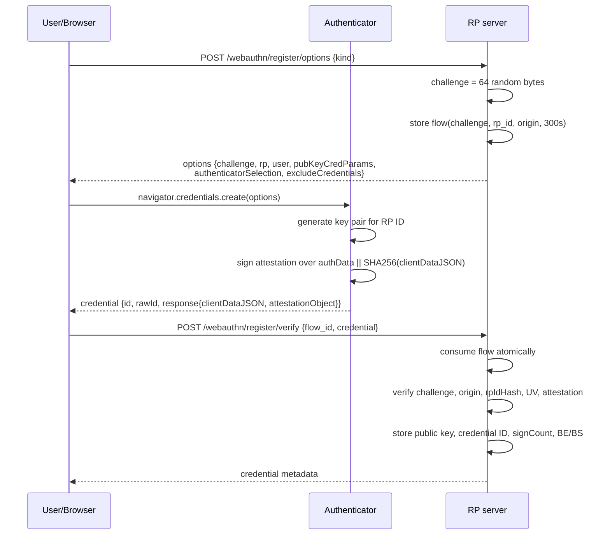
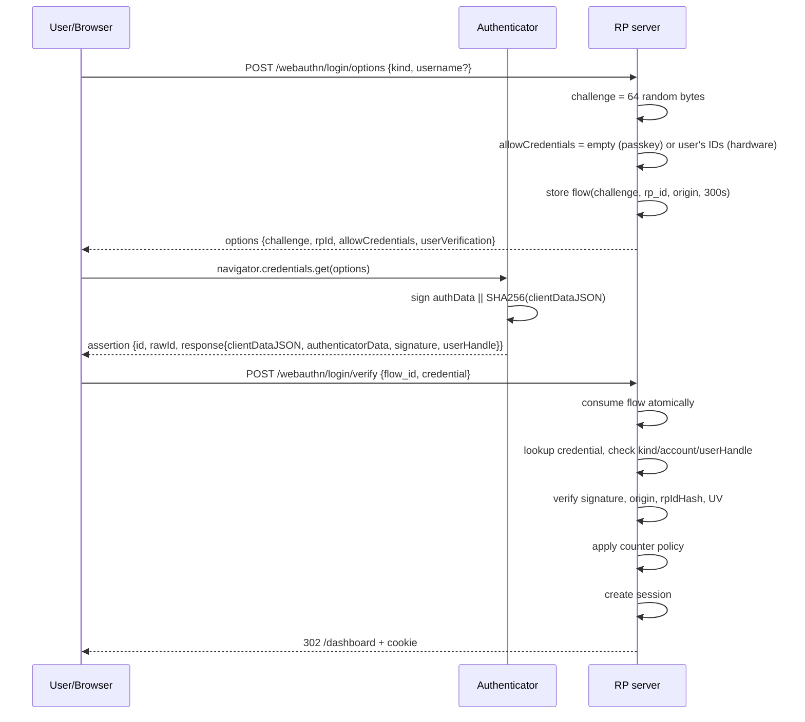

# Protocol Analysis

This document walks through the three authentication protocols at message
level, states the security invariants each one can provide, and identifies the
exact check whose omission turns a phishing-resistant credential into a
relayable one. The analysis is paired with the experiments in
`experiments/run_experiments.py`; every claim below has a corresponding
scenario ID.

## 1. Password + TOTP

### 1.1 Registration and enrolment

```
User                Browser                 RP server
 |-- username, password, confirm -->|             |
 |                                  |-- POST /register -->|
 |                                  |                    | validate username/password
 |                                  |                    | scrypt hash
 |                                  |                    | generate TOTP secret K
 |                                  |                    | generate 10 recovery codes
 |                                  |                    | create user, session (method=registration)
 |                                  |<-- 302 /enroll ----|
 |                                  |-- GET /enroll ---->|
 |                                  |<-- QR + secret + recovery codes
```

The TOTP secret is 20 random bytes, base32-encoded. The provisioning URI is
standard `otpauth://totp/...` with SHA-1, 6 digits, and a 30-second period. The
server stores `totp_last_step = -1`, meaning no code has been consumed.

### 1.2 Login transcript

```
Client                              RP server
  |-- POST /login/password ---------->|
  |   username, password              | lookup user
  |                                   | verify scrypt(password, stored)
  |                                   | throttle check
  |                                   | session["pending_user_id"] = id
  |<-- 302 /login/totp ---------------|
  |-- GET /login/totp --------------->|
  |<-- form --------------------------|
  |-- POST /login/totp --------------->|
  |   code                            | for offset in [-1, 0, +1]:
  |                                   |   t = current_step + offset
  |                                   |   if HMAC-SHA1(K, t) == code:
  |                                   |     if enforce_replay and t <= last_step:
  |                                   |       reject "replayed"
  |                                   |     else accept, last_step = t
  |                                   | create session (method=password_totp)
  |<-- 302 /dashboard + cookie --------|
```

### 1.3 Invariants

| Invariant | Implementation | Failure if missing |
| --- | --- | --- |
| Password is not stored in plaintext | scrypt `N=2^14, r=8, p=1`, 16-byte salt, 32-byte output | Offline cracking after DB leak |
| Code is fresh | ±1 step window (≈90 s) | Old codes remain valid indefinitely |
| Code is single-use | `totp_last_step` monotonic counter | Replay within window (P1d) |
| Guessing is bounded | 10 failures / 15 min per username+IP on password and TOTP steps | Online brute force |
| Origin is bound | **None** | Real-time relay (P1) |
| Recovery is possible | Email token, recovery codes | Lockout |

### 1.4 Why TOTP cannot be origin-bound

TOTP is a symmetric MAC over a time counter. The verifier knows the same secret
as the authenticator. There is no place in the code for the origin, RP ID, or a
server-generated challenge. The code is therefore a bearer token: whoever
presents it first wins. A reverse proxy can read the password and the code from
the victim's browser and submit both to the real RP. The RP sees a perfectly
valid login.

### 1.5 The replay nuance

The server's counter protects against a *second* use:

- P1b: the attacker completes the relay, then replays the same code in a new
  session. `t <= last_step` is true, so the replay is rejected 5/5.
- P1d: a naive verifier with `enforce_replay=False` accepts the same code twice
  5/5.

This is why "TOTP replay protection" should not be marketed as phishing
protection. It limits post-compromise reuse; it does not stop the first relay.
The victim may notice a failed login after the attacker has already taken over.

### 1.6 Window trade-offs

The ±1 window tolerates clock skew but extends the useful life of a code to at
most three steps. Accepting a future step (`+1`) and storing that counter means
the current step's code is now `<= last_step` and will be rejected on a second
attempt. This is a subtle usability cost:

```
current step = 100
user submits code for step 101 (clock ahead) -> accepted, last_step = 101
user later submits code for step 100       -> rejected as "replayed"
```

A production system can mitigate this by only advancing `last_step` when the
accepted counter is greater than the current step, or by treating accepted
future steps specially. AuthLab keeps the simple monotonic rule so the
experiment is easy to reason about.

## 2. WebAuthn registration

### 2.1 Message flow



### 2.2 Options fields

| Field | Value in AuthLab | Why |
| --- | --- | --- |
| `challenge` | 64 random bytes | Freshness / anti-replay |
| `rp.id` | `app.lvh.me` | RP ID scoping |
| `rp.name` | `AuthLab` | Display |
| `user.id` | 16 random bytes | Stable WebAuthn user handle |
| `user.name` | username | Account binding |
| `pubKeyCredParams` | ES256 / RS256 etc. (library default) | Algorithm negotiation |
| `timeout` | 60 s | UX |
| `attestation` | `none` | Privacy; no provenance requirement |
| `authenticatorSelection.authenticatorAttachment` | `platform` for passkey, `cross-platform` for hardware | Enrolment path |
| `authenticatorSelection.residentKey` | `required` for passkey, `preferred` for hardware | Discoverable vs allow-list |
| `authenticatorSelection.userVerification` | `required` | Presence + biometric/PIN |
| `excludeCredentials` | Existing credential IDs of the same kind | Prevent duplicate enrolment |

### 2.3 What the RP must verify

1. **Challenge** equals the stored challenge for this flow.
2. **Origin** in `clientDataJSON` is in the configured allowlist.
3. **Type** is `webauthn.create`.
4. **RP ID hash** in `authenticatorData` equals `SHA-256(expected_rp_id)`.
5. **User presence** flag is set.
6. **User verification** flag is set if UV is required.
7. **Attestation** is valid for the chosen conveyance preference.
8. **Credential ID** is new (not already registered).
9. **Public key** is stored with the credential ID and account ID.
10. **Backup flags** are recorded for policy (synced vs device-bound).

`py_webauthn` performs 1–7. AuthLab performs 8–10 explicitly. The lab's
permissive verifier deliberately skips the origin allowlist and substitutes the
origin from `clientDataJSON`, which is the exact bug that P4/P7 exploit.

### 2.4 Authenticator data layout

```
rpIdHash       32 bytes   SHA-256(rpId)
flags           1 byte    UP(0x01), UV(0x04), BE(0x08), BS(0x10), AT(0x40), ED(0x80)
signCount       4 bytes   big-endian
attestedCredData (registration only, if AT=1)
extensions      (optional, if ED=1)
```

The flags are security-relevant:

- `UP` proves a human was present.
- `UV` proves a biometric/PIN check.
- `BE` says the credential *can* be synced.
- `BS` says it *is currently* backed up.
- `AT` says attested credential data follows.
- `ED` says extension data follows.

AuthLab records `BE` and `BS` and uses them in the counter policy. It rejects a
roaming credential with `BE` or `BS` set, because that is not a hardware key.

## 3. WebAuthn authentication

### 3.1 Message flow



### 3.2 clientDataJSON

```json
{
  "type": "webauthn.get",
  "challenge": "<base64url of the 64-byte challenge>",
  "origin": "http://app.lvh.me:5010",
  "crossOrigin": false
}
```

The signature covers `SHA-256(clientDataJSON)`, so the origin and challenge are
cryptographically bound to the assertion. A relay cannot change the origin
without invalidating the signature. The only question is whether the RP
*checks* the origin it receives.

### 3.3 Why the subdomain attack works

Let the RP be `app.lvh.me`. The attacker controls `evil.app.lvh.me`.

1. The browser checks whether `app.lvh.me` is a registrable domain suffix of
   the origin host `evil.app.lvh.me`. It is: the host ends with
   `.app.lvh.me`. The authenticator is allowed to use `rpId = app.lvh.me`.
2. The assertion's `rpIdHash` is `SHA-256("app.lvh.me")`, which matches the
   RP's expectation.
3. The assertion's `origin` is `http://evil.app.lvh.me:5011`, which does **not**
   match the RP's allowlist.
4. Strict verifier: reject (P3/P6 0/5). Permissive verifier: accept (P4/P7
   5/5).

This is why "the browser enforces RP ID" is not enough. RP ID scoping prevents
a completely different domain from using the RP ID, but it does not prevent a
subdomain under the same registrable domain from doing so. Origin binding is
the second, necessary check.

### 3.4 Challenge and flow single-use

The flow record is the server's memory of the ceremony:

```sql
flow_id, user_id, purpose, kind, challenge, rp_id, origin,
created_at, expires_at, used
```

Verification calls `consume_flow(flow_id, "authenticate")`, which atomically
marks the row used:

```sql
UPDATE flows SET used = 1 WHERE flow_id = ? AND used = 0
```

If the update affects zero rows (already used, expired, wrong purpose), the
request fails. This gives two replay defenses:

- **Same-flow replay:** the flow is already used → `invalid_or_used_flow`.
- **Fresh-flow replay:** the old assertion's challenge does not match the new
  flow's challenge → verification failure.

R3/R4 test both and observe 3/3 rejection.

### 3.5 Signature counters

The counter is a 32-bit value in `authenticatorData`. The RP stores the last
seen value and applies a policy:

| Credential | Stored | New | Policy | Result |
| --- | ---: | ---: | --- | --- |
| Hardware | 1 | 2 | strict monotonic | accept |
| Hardware | 1 | 1 | strict monotonic | reject (regression) |
| Hardware clone | 1 | 11 | strict monotonic | accept (forged high) |
| Synced passkey | 1 | 0 | backup-eligible exception | accept |
| Synced passkey | 1 | 1 | backup-eligible exception | accept |

The strict check is necessary but not sufficient. It detects a clone that is
behind, not a clone that is ahead. For synced passkeys, a non-monotonic counter
is normal, so the server must relax the check; clone detection then relies on
other signals (revocation, sync-account security, risk scoring).

### 3.6 User handle and usernameless login

Passkeys use discoverable credentials, so `allowCredentials` is empty. The
authenticator returns a `userHandle`; the RP must verify that it identifies the
same account that owns the credential:

```
if userHandle:
    expected = base64url(user.webauthn_user_id)
    if not constant_time(userHandle, expected):
        reject "user_handle_mismatch"
```

This prevents an assertion for one account from being used to log in as
another. Hardware keys normally use a non-resident credential, so the username
step supplies `allowCredentials`; the account binding is then checked against
the credential row.

## 4. Synced passkeys

### 4.1 Flags and semantics

| Flag | Meaning | Consequence |
| --- | --- | --- |
| `BE=0` | Not backup eligible | Device-bound; strict counter possible |
| `BE=1, BS=0` | Backup eligible, not currently backed up | May be synced later |
| `BE=1, BS=1` | Currently backed up | May be restored on another device; counter may be non-monotonic |

AuthLab's registration path labels a platform credential "Synced passkey" only
when `device_type == multi_device`; otherwise it labels it "Platform passkey
(device-bound)". The hardware path rejects `BE=1` or `BS=1`.

### 4.2 Security argument

A synced passkey is still origin-bound and challenge-bound. Syncing does not
make it phishable; P3/P4 would apply equally to a synced credential. What
changes is:

- **Availability:** a new device can restore the credential (S1).
- **Clone detection:** counters may not be monotonic (R7).
- **Trust:** the sync provider becomes a party that can restore the credential.
- **Revocation:** deleting a device may not delete the credential everywhere;
  the RP must offer account-level revocation.

### 4.3 Modeling choice

Chrome's virtual authenticator always reports `BE=0` for platform credentials.
The harness exports the credential, re-imports it with `BE=1, BS=1`, and calls
`/lab/credentials/mark-synced` to update the server record. This is a
protocol-level model, not a vendor cloud. It is enough to test the server's
counter policy and recovery behavior; it does not test sync-provider
confidentiality or revocation propagation.

## 5. Hardware FIDO2 keys

### 5.1 Properties

- Private key is non-exportable and bound to the authenticator.
- Roaming transport (USB/NFC/BLE); `cross-platform` attachment.
- User verification via PIN or biometric; AuthLab requires UV.
- Counter is usually monotonic; the RP can use it for clone detection.
- Loss of the key means loss of that credential; a second key is required for
  availability.

### 5.2 Counter limits

R5 and R6 use the same exported credential with different counters:

- R5: clone counter 0 (arrives as 1), stored 1 → `new <= stored` → reject.
- R6: clone counter 11, stored 1 → `new > stored` → accept.

The counter is a *rollback* detector, not a clone detector. A clone that has
observed or forged a higher counter passes. This is a fundamental limitation of
monotonic counters, not an implementation bug.

### 5.3 Backup key enrollment

S4 removes key A, enrolls key B while the session is still valid, logs out, and
logs in with B. The server sees two independent credentials for the same
account. This is the correct operational pattern: enroll the backup before you
need it. The backup key is not a copy of A; it is a second credential with its
own key pair and counter.

## 6. Recovery protocols

### 6.1 Recovery codes

Generation:

```
alphabet = "ABCDEFGHJKLMNPQRSTUVWXYZ23456789"  # 32 symbols, no I/O/0/1
code = 8 random symbols -> 40 bits
format = xxxx-xxxx
hash = scrypt(normalize(code), salt, N=2^14, r=8, p=1)
```

Verification:

```
for each unused code:
    if scrypt(normalize(input), stored_salt) == stored_digest:
        atomically mark used
        create session(method=recovery_code)
```

Properties:

- **Entropy:** 40 bits per code; 10 codes. Online guessing is bounded by rate
  limiting; offline guessing requires the scrypt hash.
- **Single use:** the atomic `UPDATE ... WHERE used_at IS NULL` ensures one
  winner.
- **Recovery session restrictions:** only a `recovery_code` or `registration`
  session may change the password.
- **Post-recovery hardening:** password change rotates TOTP, revokes all prior
  sessions, and issues a fresh session.

### 6.2 Email reset

```
POST /recovery {username}
  -> always "If that account exists, a reset link has been sent."
  -> if user exists: token = 32 random bytes; store SHA-256(token), expires 15 min

GET /recovery/reset/<token>
  -> lookup by SHA-256(token), unused, unexpired
  -> render form

POST /recovery/reset/<token> {password, confirm}
  -> validate password
  -> atomically mark token used
  -> update password hash
  -> rotate TOTP secret, last_step = -1
  -> delete all recovery codes
  -> revoke all sessions
  -> show new TOTP QR
```

Properties:

- **Confidentiality at rest:** only the hash is stored.
- **Single use:** atomic `UPDATE ... WHERE used_at IS NULL`.
- **Expiry:** 15 minutes.
- **Revocation:** all sessions revoked.
- **Rotation:** password and TOTP rotated; recovery codes deleted.
- **Enumeration resistance:** uniform response.
- **Rate limiting:** password, TOTP, and recovery-code verification are
  throttled. The email-reset endpoints are enumeration-resistant, single-use,
  and expiry-bound, but AuthLab does not rate-limit the reset request itself;
  that is a production hardening step recommended in the report.

The email account is a trust anchor. If it is compromised, email reset is a
takeover path regardless of the primary factor. This is why recovery codes and
a backup key are important: they give the user a path that does not depend on
email.

### 6.3 Recovery invariants

| Invariant | Test | Observed |
| --- | --- | --- |
| Code is single-use | S6 | 3/3 reuse blocked |
| Reset token is single-use | S7 | 3/3 replay 400 |
| Reset token expires | S8 | 3/3 expired 400 |
| Old sessions are revoked | S7 | 3/3 redirected to login |
| Old password is invalid | S7 | 3/3 rejected |
| New password works | S7 | 3/3 accepted |
| TOTP is rotated | S7 | new secret used |
| Recovery codes are deleted on email reset | implementation | `DELETE FROM recovery_codes` |
| Pre-recovery sessions cannot survive password change | targeted test | 3/3 revoked |

## 7. Cross-protocol comparison

| Property | Password + TOTP | Synced passkey | Hardware key |
| --- | --- | --- | --- |
| Secret type | Bearer (password + code) | Asymmetric, non-exportable in use | Asymmetric, non-exportable |
| Origin binding | None | Signed `clientDataJSON.origin` | Signed `clientDataJSON.origin` |
| RP ID binding | None | `rpIdHash` + browser scope | `rpIdHash` + browser scope |
| Freshness | 30 s step ±1 | 64-byte challenge, single-use flow | 64-byte challenge, single-use flow |
| Replay defense | Server-side counter | Flow + challenge | Flow + challenge |
| Clone signal | None | Weak (non-monotonic allowed) | Counter (rollback only) |
| Device loss | Recoverable via email/codes | Sync restore | Backup key/codes |
| Phishing resistance | None | Conditional on RP origin check | Conditional on RP origin check |
| User verification | Password + code | Platform biometric/PIN | Key PIN/biometric |
| Main residual risk | Real-time relay | RP misconfiguration, sync account | Loss without backup |

## 8. Implementation map

| Protocol element | Code |
| --- | --- |
| TOTP generation/verification | `authlab/security.py` (`totp_at`, `verify_totp`) |
| Password hashing | `authlab/security.py` (`hash_password`, `verify_password`) |
| WebAuthn options | `authlab/webauthn_service.py` |
| Registration verification | `authlab/routes/passkeys.py` (`register_verify`) |
| Authentication verification | `authlab/routes/passkeys.py` (`_finish_authentication`) |
| Strict/permissive origin policy | `authlab/routes/passkeys.py` (`lab_login_verify`) |
| Counter policy | `authlab/webauthn_service.py` (`counter_allows`) |
| Flow single-use | `authlab/security.py` (`consume_flow`) |
| Recovery codes | `authlab/routes/recovery.py` (`recovery_code_login`) |
| Email reset | `authlab/routes/recovery.py` (`recovery_home`, `reset`) |
| Session revocation | `authlab/security.py` (`revoke_all_sessions`) |
| Lab instrumentation | `authlab/routes/lab.py` |
| Browser serialization | `authlab/static/app.js` |

## 9. Summary

The protocols differ in where they put the security property:

- TOTP puts freshness in a shared time counter and **cannot** put origin
  binding anywhere. Its best additional control is a server-side replay
  counter.
- WebAuthn puts origin and RP ID binding in the signed `clientDataJSON` and
  `authenticatorData`. The cryptographic part is strong; the **verifier's
  origin comparison** is the load-bearing check.
- Synced passkeys keep the WebAuthn checks but relax the counter and move
  availability to the sync provider.
- Hardware keys keep the WebAuthn checks and add a non-exportable key and a
  counter, but recovery becomes an operational problem.
- Recovery protocols are authentication protocols in disguise. They need the
  same single-use, expiry, revocation, and rate-limiting discipline.

The experiments are designed to make each of these statements falsifiable.
Where the system failed (P4/P7), the failure was in the verifier, not in the
cryptography. Where the system held (P1b, R3/R4, S6–S8), the control was
explicit server-side state.
