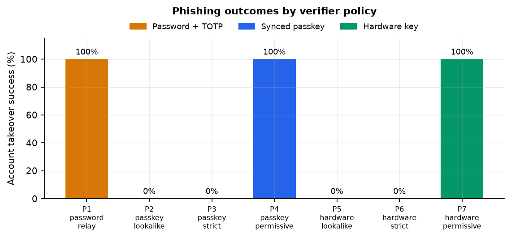
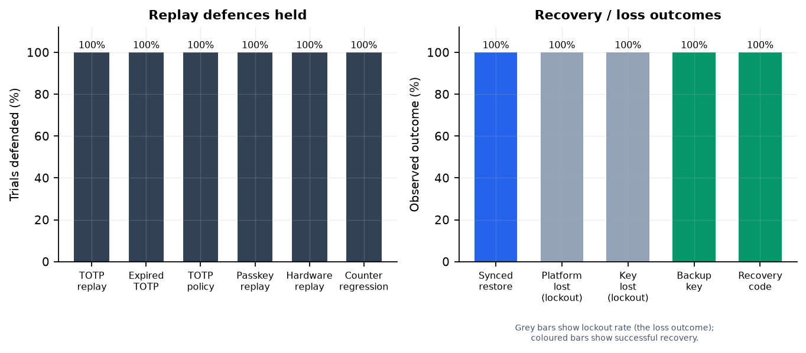
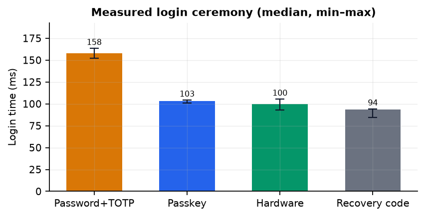

# Presentation Deck

**Beyond TOTP: Evaluating Phishing Resistance and Account Recovery in Synced
Passkeys and Hardware Security Keys**

Target length: 12–15 minutes (about 15 slides). Each slide has a short English
body and a Chinese takeaway plus speaker notes. Figures are in `../figures/`.

---

## Slide 1 — Title (0:00)

**Beyond TOTP**

Evaluating phishing resistance and account recovery in synced passkeys and
hardware security keys

4220 Project · 9 November 2026

> 中文：超越 TOTP——比較同步通行金鑰與硬體安全金鑰的釣魚抵抗與帳號復原。

**Speaker notes.** 這份報告的重點不是「哪個登入最快」，而是「哪個系統在
釣魚、重放、裝置遺失與復原濫用下仍然安全」。我會先講協定，再講實驗，最後
給部署建議。

---

## Slide 2 — Why login is not the whole account (0:45)

- Phishing is origin confusion, not cryptography breaking.
- TOTP is a bearer secret: a relay can use it in real time.
- Passkeys/hardware keys remove the bearer secret.
- But recovery codes, email reset, backup keys, and sync accounts are also
  authentication surfaces.
- A chain is only as strong as its recovery path.

> 中文：登入只是帳號的一部分；復原流程也是攻擊面。

**Speaker notes.** 很多簡報只比較登入，但帳號被攻破常見的路徑是復原。
這份研究把復原當作一等公民。

---

## Slide 3 — Four questions (1:30)

1. **Phishing:** can a real-time relay take over each method?
2. **Replay:** what stops a captured code/assertion from being used twice?
3. **Recovery:** what happens after device/key loss, and does recovery reopen
   the hole?
4. **Usability:** what is the time and cognitive cost, especially for recovery?

> 中文：釣魚、重放、復原、可用性——四個問題，三種方法。

**Speaker notes.** 每個問題都有對應的實驗 ID：P、R、S、U。

---

## Slide 4 — AuthLab testbed (2:15)

```
Browser (Chrome + CDP virtual authenticator)
   |  WebAuthn / TOTP
   v
AuthLab RP (Flask, SQLite)  <---->  hostile proxy
app.lvh.me:5010                     evil.app.lvh.me:5011
```

- Password + RFC 6238 TOTP, scrypt, sessions, throttling.
- WebAuthn registration/authentication via py_webauthn 3.0.1.
- Recovery codes, email reset tokens, session revocation, TOTP rotation.
- Lab token guards the test-only endpoints.

> 中文：自己寫一個可重現的 RP，才能把 origin 檢查與計數器政策變成可切換的
> 實驗變數。

**Speaker notes.** 用框架會把關鍵決策藏起來；AuthLab 把 origin check、
counter policy、flow single-use 都攤開來。

---

## Slide 5 — TOTP vs WebAuthn (3:00)

| | Password + TOTP | WebAuthn |
| --- | --- | --- |
| Secret | Bearer code | Private key stays in authenticator |
| Origin binding | **None** | Signed `clientDataJSON.origin` |
| Freshness | 30 s step ±1 | 64-byte challenge, single-use flow |
| Replay defense | Server-side counter | Flow + challenge |
| Phishing | Real-time relay works | Resists **if RP checks origin** |

> 中文：TOTP 沒有 origin 的概念；WebAuthn 有，但 RP 必須真的檢查。

**Speaker notes.** 這是整份報告的核心對比。WebAuthn 的密碼學很強，但
「有沒有檢查 origin」是系統層級的關鍵。

---

## Slide 6 — The subdomain nuance (4:00)

- Attacker at `evil.app.lvh.me`; RP at `app.lvh.me`.
- Browser allows `rpId = app.lvh.me` because it is a suffix.
- Authenticator signs `origin = evil.app.lvh.me`.
- Strict verifier: reject. Permissive verifier: accept.
- Same key, same signature, different verifier → different security.

> 中文：瀏覽器只管 RP ID 的後綴；origin 檢查才是釣魚抵抗的關鍵。

**Speaker notes.** 這也是為什麼 P2/P5（攻擊者用自己的 RP ID）會失敗，但
P4/P7（轉送真實 challenge 到寬鬆 RP）會成功。

---

## Slide 7 — Experiment matrix (4:45)

| Group | What | IDs |
| --- | --- | --- |
| Phishing | 3 methods × naive/strict/permissive | P1–P7 |
| Replay/counter | TOTP window, assertion replay, clones | R1–R7 |
| Recovery | sync, loss, backup, codes, email reset | S1–S8 |
| Usability | ceremony latency, error paths | U1–U2 |

25 scenarios, 3–5 trials each; Chrome + CDP virtual authenticators; loopback.

> 中文：25 個情境，每個 3–5 次；25 個都真的跑過，不是紙上推演。

**Speaker notes.** 每次 trial 都用新的資料庫、新的 browser context、新的
virtual authenticator，避免交叉污染。

---

## Slide 8 — Phishing results (5:45)



- Password + TOTP relay: **5/5 takeover**.
- Naive lookalike: passkey **0/3**, hardware **0/3**.
- Strict origin relay: passkey **0/5**, hardware **0/5**.
- Permissive origin relay: passkey **5/5**, hardware **5/5**.

> 中文：密碼+TOTP 一定被即時轉送攻破；passkey/硬體金鑰只有在 RP 不檢查
> origin 時才會被攻破。

**Speaker notes.** 這張圖是整份報告最重要的一張。注意 P4/P7 不是密碼學
被破解，是驗證邏輯寫錯。

---

## Slide 9 — Replay and counters (6:45)



- TOTP replay after takeover: **5/5 blocked** — but the takeover already
  happened.
- Naive stateless TOTP: **5/5 double use** — server state is the defense.
- WebAuthn assertion replay: **3/3 blocked** (flow + challenge).
- Hardware lagging clone: **3/3 blocked**.
- Hardware forged-high clone: **3/3 accepted** — counters detect rollback only.
- Synced non-monotonic counter: **3/3 accepted** — the price of sync.

> 中文：重放保護≠釣魚保護；計數器只能抓「落後」的克隆。

**Speaker notes.** P1 和 P1b 要一起講：攻擊者先即時轉送成功，之後重放才被
擋。這是時間順序的問題。

---

## Slide 10 — Recovery and device loss (7:45)

| Scenario | Result |
| --- | --- |
| Synced restore on a new device | **5/5 success** |
| Device-bound platform credential lost | **3/3 lockout** |
| Only hardware key lost | **3/3 lockout** |
| Backup hardware key | **3/3 success** |
| Recovery code after key loss | **3/3 success** |
| Recovery code reuse | **3/3 blocked** |
| Email reset invariants | **3/3 all hold** |
| Expired reset token | **3/3 rejected** |

> 中文：同步讓裝置遺失可活；硬體金鑰沒有備份就會鎖死；復原碼與 email
> 重設必須一次性、可撤銷、會輪替。

**Speaker notes.** 對硬體金鑰來說，備用金鑰不是選配，是營運必要。

---

## Slide 11 — Usability (8:45)



- Measured login ceremony: 158 ms (password+TOTP), 103 ms (passkey), 100 ms
  (hardware).
- KLM human estimate: **13.5 s**, **3.5 s**, **4.0 s**.
- Recovery code: 9.2 s; email reset: 18.2 s + delivery.
- Hardware loss without backup is not a 10-second cost; it is a support
  incident.

> 中文：日常登入 passkey/硬體約快 3–4 倍；但硬體遺失的成本是復原，不是登入。

**Speaker notes.** 量測只包含儀式，不包含人的思考與輸入；KLM 是分析模型，
不是人類資料。人類研究協議已附上但未執行。

---

## Slide 12 — The central lesson (9:45)

**Phishing resistance is a system property.**

- The credential did not change between P3 and P4.
- The verifier did.
- The same is true for P6 and P7.

Controls that matter:

- strict `clientDataJSON.origin` allowlist;
- `rpIdHash` check;
- fresh 64-byte challenge + single-use flow;
- UV;
- explicit counter policy;
- hardened recovery.

> 中文：不是「用了 passkey 就安全」，而是「RP 正確驗證 + 復原流程堅固」才
> 安全。

**Speaker notes.** 這是報告的一句話總結。

---

## Slide 13 — Recommendations (10:45)

1. **Consumer:** synced passkey by default; strict origin check; recovery codes
   + hardened email reset; account-level revocation.
2. **High assurance:** hardware key + backup key; strict counters; recovery
   codes in escrow; no email-only reset.
3. **Legacy:** keep TOTP with replay state and rate limits, but do not call it
   phishing-resistant; plan migration.
4. **Test negative paths:** wrong origin, wrong RP ID, replayed challenge,
   expired token, reused code.

> 中文：passkey 當預設、硬體金鑰要備份、復原要一次性與可撤銷、測試負面
> 情境。

**Speaker notes.** 這些建議是從實驗結果直接推出來的，不是一般性口號。

---

## Slide 14 — Limitations (11:45)

- Virtual authenticators, not physical keys.
- Loopback, not WAN; no real email delivery.
- Chrome only.
- 3–5 trials per scenario; wide Wilson intervals.
- No human-subject data; KLM is analytic.
- No formal verification.
- The permissive verifier is a lab-only vulnerability.

> 中文：這是控制實驗，不是大規模田野研究；結論是協定層級的，不是母體比例。

**Speaker notes.** 主動講限制，比被問到好。下一步是實體金鑰、多瀏覽器與
人類研究。

---

## Slide 15 — Conclusion / Q&A (12:30)

- TOTP: replay protection works, phishing protection does not.
- Passkeys: great if the RP checks origin; sync trades clone detection for
  availability.
- Hardware keys: strong primary factor; recovery is the weak link.
- Recovery is an authentication surface; design and test it like one.

**Thank you. Questions?**

> 中文：TOTP 防重放不防釣魚；passkey 的關鍵在 RP；硬體金鑰的關鍵在備份；
> 復原就是另一個登入系統。

**Speaker notes.** 最後留 2–3 分鐘問答。備用一張附錄投影片放原始數據位置與
聯絡方式。
